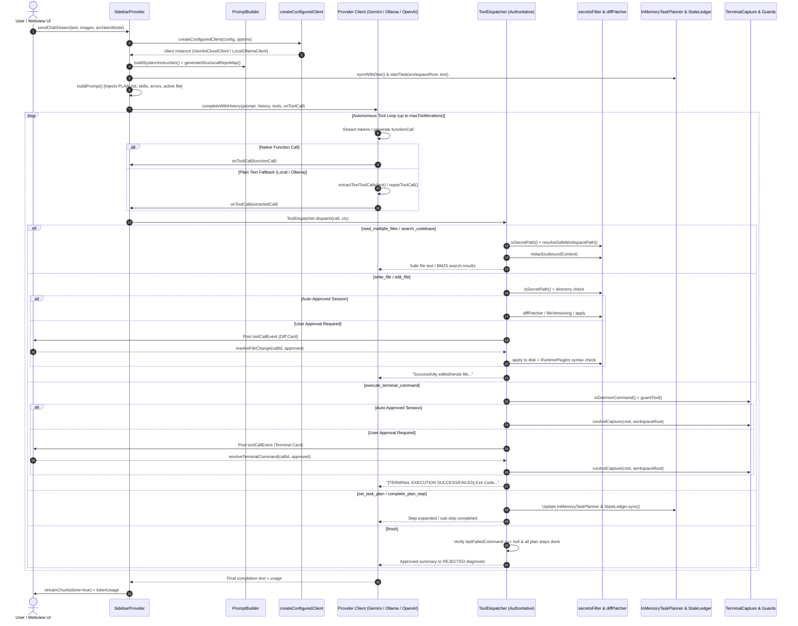
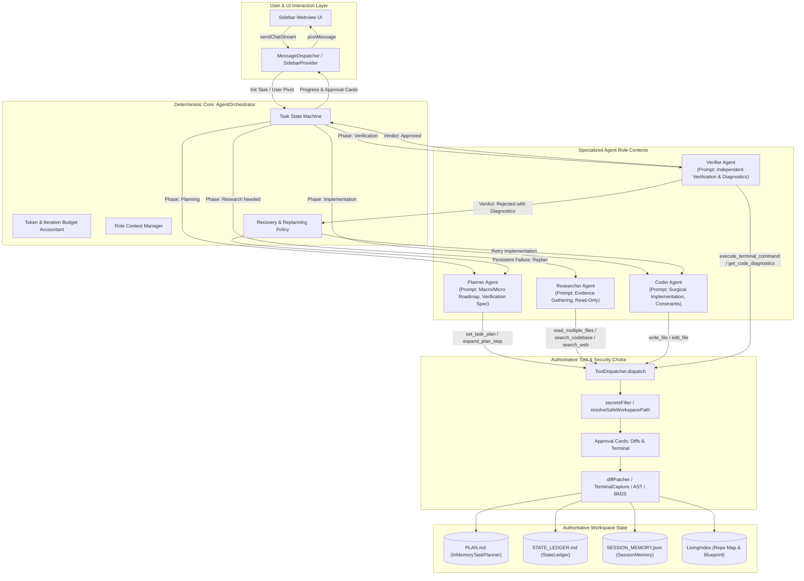
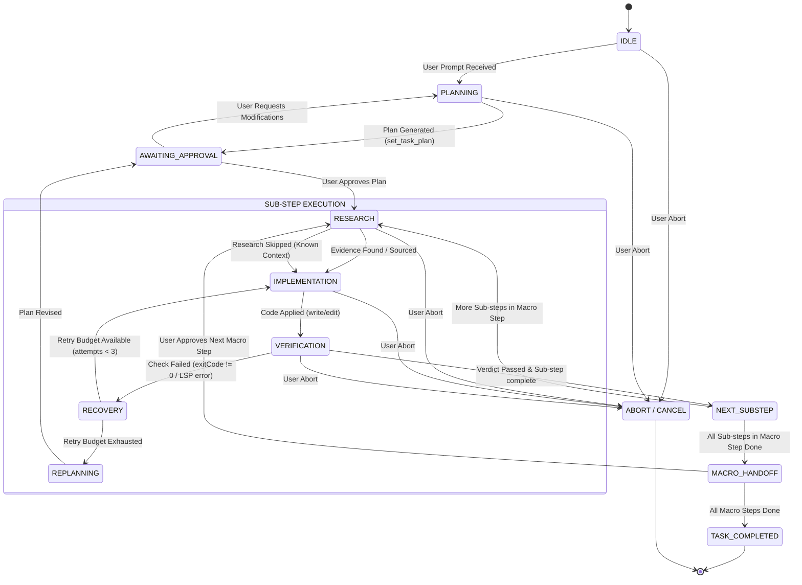

# VAKRA_CONTROL — Multi-Agent System Architecture & Integration Plan

**Document Version**: 1.0.0  
**Status**: Architecture Design & Specification (Phase 4 Ready)  
**Target System**: `vakra_control` VS Code Extension (`ultra-light-ai`)  
**Baseline Verification**: 74 Mocha tests passing, 0 type errors (`tsc -p .`), exit code 0  

---

## 1. Executive Recommendation and Explicit Non-Goals

### 1.1 Executive Recommendation: The Deterministic Harness Multi-Agent Pattern

In autonomous coding agents (notably Claude Code and Google Antigravity), multi-agent reliability is not achieved by running five LLMs simultaneously in a conversational chat room or having an LLM orchestrate every minor turn. That naive approach causes **token explosion, high latency, context dilution, non-deterministic state drifting, and infinite loop cascades**—especially catastrophic on 4B–8B local models (Ollama, llama-server) and quota-constrained cloud APIs.

We recommend a **Deterministic Harness Orchestrator** paired with **Four On-Demand Role Specialists**:

```
                              ┌────────────────────────────────────────┐
                              │       AgentOrchestrator (TS Code)       │
                              │  - Deterministic State Machine          │
                              │  - Authoritative Task Ledger & Budget   │
                              │  - Loop & Timeout Detection             │
                              │  - Strict Tool-Permission Enforcement   │
                              └───────────────────┬────────────────────┘
                                                  │
            ┌─────────────────────┬───────────────┴───────────────┬─────────────────────┐
            ▼                     ▼                               ▼                     ▼
     ┌─────────────┐       ┌─────────────┐                 ┌─────────────┐       ┌─────────────┐
     │   Planner   │       │ Researcher  │                 │    Coder    │       │  Verifier   │
     │  Specialist │       │ Specialist  │                 │ Specialist  │       │ Specialist  │
     │ (On-Demand) │       │ (On-Demand) │                 │ (Per Step)  │       │ (Mandatory) │
     └──────┬──────┘       └──────┬──────┘                 └──────┬──────┘       └──────┬──────┘
            │                     │                               │                     │
            └─────────────────────┴───────────────┬───────────────┴─────────────────────┘
                                                  │ Dispatches Tool Requests
                                                  ▼
                              ┌────────────────────────────────────────┐
                              │         ToolDispatcher (Choke)         │
                              │  - Path Containment (resolveSafePath)   │
                              │  - Secrets Denial & Redaction          │
                              │  - User Approval Gates (Diff & Shell)  │
                              │  - Post-Write AST & Syntax Validation  │
                              └────────────────────────────────────────┘
```

1. **Deterministic State Machine (The Orchestrator)**: Implemented in pure TypeScript code (`AgentOrchestrator`). It manages task phases, step transitions, budget accounting, retry limits, loop detection, and user handoffs. It invokes LLM specialist roles only when semantic reasoning or generation is needed.
2. **On-Demand Planner Role**: Invoked at task initialization, when a user pivots, or when repeated verification failures invalidate initial assumptions. Generates verifiable macro and micro milestones in `PLAN.md`.
3. **On-Demand Researcher Role**: Read-only specialist invoked only when file symbols, architecture dependencies, or external web documentation are required before writing code. Banned from file modifications and terminal command execution.
4. **Focused Coder Role**: Surgical code implementer. Receives only the active sub-step, relevant file snippets, and research evidence. Granted `write_file`, `edit_file`, and symbol replacement. Banned from marking tasks complete or running verification assertions.
5. **Independent Verifier Role**: Objective evaluator. Runs compilation diagnostics, AST outline validation, and non-daemon test/build commands in `TerminalCapture`. Evaluates real exit codes, stdout/stderr, and file diffs. Possesses sole authority to approve plan step completion or reject with a structured `VerificationFailure` back to the Coder.

### 1.2 Explicit Non-Goals

- **No Multi-Model Concurrency Overhead**: We will not run 5 models in parallel or require separate local instances. All roles run sequentially using the configured active model (or an optional lightweight model tier if configured).
- **No LLM Self-Orchestration**: The LLM will not decide its own lifecycle transitions, step progression, or completion criteria. State transitions are strictly enforced in code.
- **No Unrestricted Terminal or Filesystem Access**: Sub-agents cannot bypass `ToolDispatcher` or spawn arbitrary unmonitored sub-shells.
- **No Secondary Subsystems**: We will not build duplicate planners, memory stores, diff patchers, or secret filters. Existing tested components (`InMemoryTaskPlanner`, `SessionMemory`, `StateLedger`, `secretsFilter`, `diffPatcher`) will be extended, not duplicated.
- **No UI Redesign**: The existing Webview chat and card approval UI in `ui.html` remains the user-facing surface.
- **No External Multi-Agent Frameworks**: No LangChain, CrewAI, AutoGen, or heavy third-party agent runtimes will be introduced. Everything is implemented in native TypeScript matching the extension's lightweight architecture.

---

## 2. Current Runtime Flow Verified from Source

The active single-agent execution path was verified across `src/router/realClients.ts`, `src/webview/sidebarProvider.ts`, `src/webview/tools/toolDispatcher.ts`, `src/state/inMemoryTaskPlanner.ts`, `src/state/sessionMemory.ts`, and `src/state/stateLedger.ts`.

### 2.1 Verified End-to-End Sequence



### 2.2 Shortcomings of the Current Single-Agent Flow

1. **Self-Verification Vulnerability**: The model writing the code is the exact same prompt context verifying it. Models frequently rationalize bugs, ignore subtle edge cases, or skip running verification tests.
2. **Volatile Context Bloat**: Raw terminal outputs and 300-line file inspections accumulate in conversation history, causing small models (4B–8B) to lose instruction adherence.
3. **Overloaded Tool Space**: In every turn, the model sees 14+ tools simultaneously, leading local models to make erratic tool choices (e.g. attempting to run `write_file` during research or editing `.env` during debugging).
4. **Monolithic Turn Loop**: `SidebarProvider.handleChatMessageStream` acts as UI handler, context assembler, tool mediator, and turn coordinator in a single 855-line file.

---

## 3. Proposed Architecture Diagram

The proposed multi-agent system introduces an explicit, deterministic `AgentOrchestrator` that drives specialized role prompts through the unified `createConfiguredClient` and `ToolDispatcher`.



---

## 4. Responsibilities and Boundaries of Each Logical Role

| Logical Role | Primary Responsibility | Allowed Tools | Prohibited Tools | Invocations per Sub-Step | Context Strategy |
| :--- | :--- | :--- | :--- | :--- | :--- |
| **Orchestrator** *(Code)* | Authoritative state machine; selects active role; tracks budgets, retries, and timeouts; controls tool gating. | Pure TypeScript Controller; delegates to `ToolDispatcher`. | Cannot generate speculative code or hallucinatory transitions. | 0 model calls (Deterministic code). | Maintains task ledger, active role, iteration counter, and error stack. |
| **Planner** *(Model)* | Converts user intent into concrete, verifiable macro steps and sub-steps with explicit acceptance criteria. | `set_task_plan`, `expand_plan_step`, `read_state_ledger`, `list_directory_tree`. | `write_file`, `edit_file`, `execute_terminal_command`, `finish`. | 1 call on task start; 1 on user pivot; 1 on unrecoverable failure. | Ingests user request, structural repo map, and project conventions. |
| **Researcher** *(Model)* | Gathers targeted evidence (file snippets, symbols, documentation, error logs); outputs concise findings. | `read_multiple_files`, `search_codebase`, `list_directory_tree`, `get_symbol_outline`, `search_web`. | `write_file`, `edit_file`, `execute_terminal_command`, `set_task_plan`, `finish`. | 0 to 1 call per sub-step (skipped if context is already present). | Read-only slice; clamps file reads to max 3 files and line-ranges. |
| **Coder** *(Model)* | Implements approved changes surgically using existing patch and write tools. | `write_file`, `edit_file`, `replace_symbol`. | `execute_terminal_command`, `set_task_plan`, `complete_plan_step`, `finish`. | 1 to 2 calls per sub-step (initial + targeted fix if rejected). | Receives sub-step blueprint, specific file lines, research findings, and `STATE_LEDGER.md`. |
| **Verifier** *(Model)* | Evaluates diffs, AST syntax, diagnostics, and test execution results. Grants completion authority. | `execute_terminal_command`, `get_code_diagnostics`, `complete_plan_step`, `finish`. | `write_file`, `edit_file`, `set_task_plan`. | Exactly 1 call per sub-step. | Receives sub-step acceptance criteria, applied diff summary, and command outputs. |

### 4.1 Implementation Model: Roles as Contexts vs. Independent Models

To respect small local models (4B–8B) and cloud rate limits, **all five roles do not require five distinct models or separate running servers**:
- **Same Model, Specialized Prompts**: By default, the active configured model (`createConfiguredClient`) executes all roles. The Orchestrator swaps the prompt persona, tool availability, and input payload for each invocation.
- **Strict Role Boundaries via Tool Gating**: A Coder *cannot* claim success because the `finish` and `complete_plan_step` tools are stripped from its tool declarations. A Researcher *cannot* alter files because `write_file` and `edit_file` are physically withheld.
- **Model Overhead Control**: For a standard 1-substep edit:
  - Planner: 0 calls (if existing plan) or 1 call (at startup).
  - Researcher: 0 calls (if file is known) or 1 call.
  - Coder: 1 call.
  - Verifier: 1 call.
  - Total: **2 to 3 calls per sub-step**, completely avoiding the 6–10 call bloat of unconstrained multi-agent frameworks.

---

## 5. Typed Contracts and State-Transition Model

All state transitions, agent inputs, outputs, and tool requests must use strict TypeScript interfaces.

### 5.1 Agent Role Definitions & Data Contracts

```typescript
// Proposed location: src/agents/types.ts

export type AgentRoleType = 'orchestrator' | 'planner' | 'researcher' | 'coder' | 'verifier';

export type TaskStatus = 'idle' | 'planning' | 'awaiting_approval' | 'executing' | 'verifying' | 'recovering' | 'completed' | 'failed' | 'aborted';

export interface AgentEvidence {
    filepath: string;
    startLine?: number;
    endLine?: number;
    symbols?: string[];
    snippet?: string;
    relevance: string;
}

export interface ResearchFindings {
    summary: string;
    targetFiles: string[];
    evidence: AgentEvidence[];
    externalDocs?: Array<{ title: string; url: string; extract: string }>;
    recommendedApproach: string;
}

export interface CodeChangeSpec {
    filepath: string;
    action: 'create' | 'edit';
    reason: string;
    diffSnippet?: string;
}

export interface CoderResult {
    summary: string;
    changes: CodeChangeSpec[];
    blueprint: {
        targetFiles: string[];
        logicAddedOrModified: string;
        verificationCommandSuggestion?: string;
    };
}

export interface VerificationVerdict {
    passed: boolean;
    exitCode?: number;
    diagnosticsChecked: boolean;
    diagnosticsErrors: string[];
    testOutput?: string;
    failureReason?: string;
    suggestedFix?: string;
}

export interface TaskStepContract {
    id: string; // e.g., "1.1"
    parentId: number; // e.g., 1
    title: string;
    acceptanceCriteria: string[];
    status: 'pending' | 'in_progress' | 'verifying' | 'done' | 'failed';
    attempts: number;
    maxAttempts: number;
    research?: ResearchFindings;
    codeResult?: CoderResult;
    verdict?: VerificationVerdict;
}
```

### 5.2 Orchestrator Authoritative State Machine

```typescript
// Proposed location: src/agents/orchestratorState.ts

export interface OrchestratorBudget {
    maxTotalTokens: number;
    usedTotalTokens: number;
    maxToolIterations: number;
    usedToolIterations: number;
    maxStepRetries: number;
    timeoutSeconds: number;
}

export interface OrchestratorTaskSession {
    sessionId: string;
    userPrompt: string;
    workspaceRoot: string;
    status: TaskStatus;
    activeRole: AgentRoleType;
    activeStepId?: string;
    budget: OrchestratorBudget;
    plan: TaskStepContract[];
    historySummaries: string[];
    lastFailedCommand: string | null;
    abortController: AbortController;
}
```

### 5.3 State Transition Machine



### 5.4 Anti-Hallucination and Verification Strictness Protocol

To ensure agents never claim work is done without empirical proof:
1. **Tool Withholding**: The `finish` and `complete_plan_step` tools are strictly omitted from Coder and Researcher schemas. They are only provided to the Verifier.
2. **Deterministic Verification Gate in ToolDispatcher**: Even if an LLM emits `finish` or `complete_plan_step` in text, `ToolDispatcher` checks:
   - `lastFailedCommand === null`
   - Active terminal command exit code === 0
   - Zero unresolved compiler/LSP diagnostic errors in touched files (`get_code_diagnostics`)
   - All plan steps marked complete in `InMemoryTaskPlanner`
3. **Structured Verification Failure**: When verification fails, the orchestrator constructs a typed diagnostic payload:
   ```json
   {
     "verdict": "REJECTED",
     "stepId": "1.2",
     "command": "npm test",
     "exitCode": 1,
     "stderr": "AssertionError: expected false to be true at test/auth.test.ts:42",
     "requiredAction": "Read test/auth.test.ts line 40-50, fix logic in src/auth.ts, and re-test."
   }
   ```
   This payload is passed directly to the Coder as the subsequent turn prompt, preventing hallucinated explanations.

---

## 6. Agent Orchestration and Recovery Flow

### 6.1 Sequential Execution Algorithm

The Orchestrator executes a deterministic loop:

```typescript
// Conceptual algorithm inside AgentOrchestrator.execute()
while (!session.abortController.signal.aborted && session.status !== 'completed') {
    const currentStep = session.plan.find(s => s.status === 'in_progress') 
                     || session.plan.find(s => s.status === 'pending');
    
    if (!currentStep) {
        // All planned steps completed
        session.status = 'completed';
        break;
    }

    currentStep.status = 'in_progress';
    
    // 1. RESEARCH PHASE (On-demand)
    if (this.needsResearch(currentStep, session)) {
        session.activeRole = 'researcher';
        currentStep.research = await this.runResearcher(currentStep, session);
    }
    
    // 2. IMPLEMENTATION & VERIFICATION LOOP (Bounded retries)
    let verified = false;
    while (currentStep.attempts < currentStep.maxAttempts && !verified) {
        currentStep.attempts++;
        session.budget.usedTotalTokens += ...;
        
        // Coder turn
        session.activeRole = 'coder';
        currentStep.codeResult = await this.runCoder(currentStep, session);
        
        // Verifier turn
        session.activeRole = 'verifier';
        const verdict = await this.runVerifier(currentStep, session);
        currentStep.verdict = verdict;
        
        if (verdict.passed) {
            verified = true;
            currentStep.status = 'done';
            await this.commitSubStepProgress(currentStep, session);
        } else {
            // Recovery loop
            if (currentStep.attempts >= currentStep.maxAttempts) {
                session.status = 'recovering';
                await this.handleUnrecoverableStepFailure(currentStep, session);
                break;
            }
            // Prepare targeted diagnostic feedback for coder retry
            session.historySummaries.push(`Attempt ${currentStep.attempts} failed: ${verdict.failureReason}`);
        }
    }
}
```

### 6.2 Failure Recovery Matrix

| Failure Mode | Trigger Condition | Automated Recovery Action | Fallback Escalation |
| :--- | :--- | :--- | :--- |
| **Syntax Error** | `validateFile` or `afterFileWrite` reports syntax failure | Auto-revert file via `FileVersioning`, forward syntax error message to Coder for surgical retry. | If 2 failed attempts: prompt Verifier for AST diagnostics. |
| **Test Assertion Failure** | Verification command exit code !== 0 | Capture tail 25 lines of stdout/stderr, format as `VerificationFailure`, send to Coder. | If 3 attempts fail: pause and prompt user for architectural guidance or trigger Planner replan. |
| **Path Traversal / Secret Denial** | Agent requests `.env` or path outside workspace | Return structured `ACCESS DENIED` without leaking contents. Record denial in session memory. | Warn model; do not increment step attempt counter. |
| **Infinite Loop / Repeat Call** | `LoopDetector` catches identical tool call with same arguments | Return `[LOOP PREVENTED]` notice immediately without dispatching; force role to explain reasoning. | If repeated 3 times: abort turn and request human input. |
| **Long-Running Server Command** | Command matches `TerminalCapture.isDaemonCommand` | Block immediately with `BLOCKED: Continuous process detected`. Instruct agent to run finite check. | Zero process hung; returns control in 0ms. |

---

## 7. Context and Token-Budget Strategy for Local and Cloud Models

Small local models (Gemma 4B, Llama-3 8B, Qwen 2.5 7B) have limited effective context windows and struggle with distraction when bloated histories are passed. Cloud models (Gemini 1.5 Pro, Claude 3.5 Sonnet) have massive contexts but incur latency and rate limits.

### 7.1 Tiered Context Allocation

| Context Component | Small Local Model (Ollama 8K–32K) | Cloud Model (Gemini / OpenAI 128K+) | Strategy & Pruning Rule |
| :--- | :--- | :--- | :--- |
| **System Instruction (Role HEAD)** | 600 – 900 tokens | 1,200 – 1,800 tokens | Byte-identical per role to maximize KV-cache reuse. |
| **Active Project Plan (`PLAN.md`)** | 400 – 600 tokens | 800 – 1,200 tokens | Render only active macro step and immediate sub-steps. |
| **State Ledger (`STATE_LEDGER.md`)**| 600 – 1,000 tokens | 2,500 – 4,000 tokens | Compact slice via `StateLedger.getCompactPromptSlice`. |
| **Repo Map (`LivingIndex`)** | 400 tokens (Hot files only) | 1,500 tokens (Full outline) | Filtered to entry points and touched files. |
| **File Read Inspection Context** | Max 1,200 tokens (Clamped) | Max 4,000 tokens | **Volatile Context Pruning**: Cleared immediately when sub-step completes! |
| **Conversation History** | Last 2 turns only (~1,500 tok) | Last 8 turns (~8,000 tok) | Summarized into `STATE_LEDGER.md` rather than replaying raw turns. |
| **Output Token Budget** | 2,048 tokens | 4,096 – 8,192 tokens | Controlled via `maxOutputTokens`. |

### 7.2 The Volatile Context Pruning Rule

In the existing `LocalOllamaClient` (verified in `src/router/realClients.ts:1440-1453`), a primitive pruning mechanism was introduced:
```typescript
if (tc.name === 'complete_plan_step') {
    // Wipes dead-weight raw file dumps from prior steps
    m.content = `[Tool Result (read_multiple_files)]: (Files inspected in previous step. Key architecture saved in STATE_LEDGER.md)`;
}
```
In the multi-agent architecture, the `AgentOrchestrator` formalizes this:
- **Each role gets an ephemeral scratchpad**.
- When the Coder completes a sub-step, raw file contents from `read_multiple_files` and terminal outputs from `execute_terminal_command` are **not carried forward into subsequent sub-steps**.
- Only the **verified facts** written to `STATE_LEDGER.md` and the updated `PLAN.md` persist across sub-step boundaries.

---

## 8. Security, Approvals, Cancellation, and Tool Execution Design

### 8.1 Single Authoritative Execution Choke-Point

Under no circumstances will any sub-agent execute a tool through a private shell or direct file write. **All roles dispatch strictly through `ToolDispatcher.dispatch()`**:

```
Role Specialist ──► ToolDispatcher.dispatch() ──► resolveSafeWorkspacePath()
                                              ──► isSecretPath() (Deny .env/keys)
                                              ──► User Approval Gate (Diff/Shell)
                                              ──► diffPatcher / TerminalCapture
                                              ──► validateFile / Syntax Guard
```

### 8.2 Role-Based Tool Permission Matrix

| Tool Name | Planner | Researcher | Coder | Verifier | Enforcement Mechanism |
| :--- | :---: | :---: | :---: | :---: | :--- |
| `read_multiple_files` | ❌ | ✅ | ⚠️ *(Read-only)* | ⚠️ *(Read-only)* | Schema filtering + Dispatcher check |
| `search_codebase` | ❌ | ✅ | ❌ | ❌ | Schema filtering |
| `list_directory_tree` | ✅ | ✅ | ❌ | ❌ | Schema filtering |
| `get_symbol_outline` | ❌ | ✅ | ❌ | ✅ | Schema filtering |
| `search_web` / `research_web_docs` | ❌ | ✅ | ❌ | ❌ | Schema filtering |
| `set_task_plan` | ✅ | ❌ | ❌ | ❌ | Schema filtering + Plan lock |
| `expand_plan_step` | ✅ | ❌ | ❌ | ❌ | Schema filtering + Plan lock |
| `write_file` | ❌ | ❌ | ✅ | ❌ | Schema filtering + Secret filter + Approval card |
| `edit_file` | ❌ | ❌ | ✅ | ❌ | Schema filtering + Secret filter + Approval card |
| `execute_terminal_command` | ❌ | ❌ | ❌ | ✅ | Schema filtering + Daemon block + Approval card |
| `get_code_diagnostics` | ❌ | ❌ | ❌ | ✅ | Schema filtering |
| `complete_plan_step` | ❌ | ❌ | ❌ | ✅ | Strictly withheld until Verifier approves |
| `finish` | ❌ | ❌ | ❌ | ✅ | Strictly withheld until all steps pass |

### 8.3 Preservation of Phase 2 Security Guarantees

1. **Path Containment**: `resolveSafeWorkspacePath()` enforces workspace root containment, Windows case normalization, and symlink breakout denial for every file operation across all agents.
2. **Secrets Protection**: `isSecretPath()` detects `.env`, `.env.*`, `*.pem`, `id_rsa`, `.aws`, `.ssh`, and credential files, returning `ACCESS DENIED` before disk reads or writes. `redact()` scrubs API keys from any outbound text.
3. **Approval Gates**: `isEditSessionAutoApproved` and `isTerminalSessionAutoApproved` continue to require explicit user confirmation via Webview cards unless the user deliberately enables session auto-approval.
4. **Daemon Command Neutralization**: `TerminalCapture.isDaemonCommand()` instantly blocks long-running dev servers (`runserver`, `npm start`, `vite`) with zero UI freezing.

### 8.4 Unified Cancellation Propagation

When the user clicks "Stop Generation" or sends `stopGeneration`:
1. `OrchestratorTaskSession.abortController.abort()` is called.
2. The active `AbortSignal` immediately cancels pending fetch streams in `realClients.ts`.
3. `TerminalCapture.cancelActive()` kills running child processes on Windows/Linux (`taskkill /T /F` or `SIGKILL`).
4. Pending approval promises in `pendingEditResolvers` and `pendingTerminalResolvers` are rejected cleanly without lingering listeners.
5. Disk state remains consistent (no half-patched files).

---

## 9. Existing Components to Reuse, Extend, Refactor, or Remove

### 9.1 Classification Matrix

| Component | File Path | Current Status | Architecture Decision | Rationale |
| :--- | :--- | :--- | :--- | :--- |
| `ToolDispatcher` | `src/webview/tools/toolDispatcher.ts` | Active, unified | **Reuse Unchanged** | Single authoritative tool execution path. Contains approval gates, secret filters, and finish checks. |
| `secretsFilter` | `src/security/secretsFilter.ts` | Active, verified | **Reuse Unchanged** | Hardened in Phase 2; perfectly protects credentials and redacts outbound keys. |
| `diffPatcher` & `fileVersioning` | `src/operations/diffPatcher.ts`, `fileVersioning.ts` | Active, verified | **Reuse Unchanged** | Reliable diff application, context anchors, and automatic snapshot backups. |
| `TerminalCapture` & `guards` | `src/tools/terminalCapture.ts`, `src/guards/toolGuards.ts` | Active, verified | **Reuse Unchanged** | Non-blocking execution, daemon detection, and ANSI stripping. |
| `validators` | `src/validators/index.ts` | Active, verified | **Reuse Unchanged** | JSON, CSS, and Python syntax guards. |
| `createConfiguredClient` | `src/router/realClients.ts` | Active, unified | **Reuse Unchanged** | Factory for Gemini, Ollama, OpenAI, Groq, OpenRouter. Multi-agent roles instantiate through this. |
| `InMemoryTaskPlanner` | `src/state/inMemoryTaskPlanner.ts` | Active, 2-level | **Extend** | Add sub-step acceptance criteria and verification result tracking to `PlanStep`. |
| `StateLedger` | `src/state/stateLedger.ts` | Active, disk markdown | **Extend** | Add role evidence summaries and structured diagnostic history. |
| `SessionMemory` | `src/state/sessionMemory.ts` | Active, JSON cache | **Extend** | Track per-role token usage and active sub-step evidence cache. |
| `LivingIndex` & `ragEngine` | `src/indexer/livingIndex.ts`, `src/rag/ragEngine.ts` | Active | **Reuse Unchanged** | Provides structural blueprints and BM25 search to Researcher role. |
| `PromptBuilder` | `src/webview/promptBuilder.ts` | Active, monolithic HEAD | **Refactor** | Modularize into role-specific prompt templates (`PlannerPrompt`, `ResearcherPrompt`, `CoderPrompt`, `VerifierPrompt`). |
| `SidebarProvider` | `src/webview/sidebarProvider.ts` | Active, monolithic turn loop | **Refactor** | Delegate turn handling and autonomous tool iteration to `AgentOrchestrator`; retain Webview view provider duties. |

---

## 10. Exact Proposed File-Level Changes

No existing files will be renamed, reformatted, or deleted in this architecture phase. The table below outlines the proposed file changes for the subsequent implementation phase:

| Action | Target Path | Responsibility & Rationale |
| :--- | :--- | :--- |
| **Create** | `src/agents/types.ts` | Typed interfaces for agent roles, inputs, outputs, verdicts, evidence, and step contracts. |
| **Create** | `src/agents/agentOrchestrator.ts` | Core deterministic state machine; manages role transitions, budget accounting, retries, and user handoff. |
| **Create** | `src/agents/roles/plannerRole.ts` | Specialized Planner role handler: sets up `PLAN.md` macro roadmap and verifiable sub-steps. |
| **Create** | `src/agents/roles/researcherRole.ts` | Specialized Researcher role handler: executes read-only queries and distills evidence. |
| **Create** | `src/agents/roles/coderRole.ts` | Specialized Coder role handler: receives targeted evidence, outputs surgical file edits. |
| **Create** | `src/agents/roles/verifierRole.ts` | Specialized Verifier role handler: runs tests, checks diagnostics, approves or rejects diffs. |
| **Create** | `src/agents/prompts/rolePrompts.ts` | Role-specific prompt templates enforcing micro-kernel execution and tool restrictions. |
| **Extend** | `src/state/inMemoryTaskPlanner.ts` | Add acceptance criteria and attempt tracking fields to `PlanStep` and `SubStep`. |
| **Refactor**| `src/webview/sidebarProvider.ts` | Replace monolithic `handleChatMessageStream` loop with a clean delegation call to `AgentOrchestrator.execute()`. |
| **Create** | `src/test/suite/multiAgentContracts.test.ts` | Unit tests for agent contracts, state transitions, budget bounds, and tool permission gates. |
| **Create** | `src/test/suite/multiAgentWorkflow.test.ts` | End-to-end integration test of Planner → Coder → Verifier → Recovery workflow. |

---

## 11. Test Strategy

The multi-agent system will be verified using a 5-tier test pyramid executed under the standalone Mocha runner (`npx mocha`) and VS Code test runner:

```
                  ┌────────────────────────────────────────┐
                  │ Tier 5: E2E Autonomous Workflow Test   │
                  │  (Inspect -> Edit -> Fail -> Fix -> Pass)
                  ├────────────────────────────────────────┤
                  │ Tier 4: Security & Permission Matrix   │
                  │  (Role tool gating & secret containment)
                  ├────────────────────────────────────────┤
                  │ Tier 3: Recovery & Replanning Suite    │
                  │  (Retry limits, loop prevention, abort)
                  ├────────────────────────────────────────┤
                  │ Tier 2: Mocked Provider Role Tests     │
                  │  (Simulated streams for each specialist)
                  ├────────────────────────────────────────┤
                  │ Tier 1: State Machine & Typed Contracts│
                  │  (State transitions, budgets, schemas)  │
                  └────────────────────────────────────────┘
```

### 11.1 Test Breakdown

1. **Tier 1 — State Machine & Contract Validation (`multiAgentContracts.test.ts`)**:
   - Verify state transitions (`IDLE` → `PLANNING` → `RESEARCH` → `IMPLEMENTATION` → `VERIFICATION` → `DONE`).
   - Validate that invalid transitions throw predictable errors.
   - Test budget exhaustion triggers stop conditions cleanly.
2. **Tier 2 — Mocked Provider Specialist Tests (`multiAgentRoles.test.ts`)**:
   - Test Planner parses macro steps and assigns acceptance criteria.
   - Test Researcher extracts file references without modifying disk.
   - Test Coder emits valid diff parameters.
   - Test Verifier produces structured `VerificationFailure` on exit code 1.
3. **Tier 3 — Recovery, Loop & Abort Lifecycle**:
   - Verify Coder retries up to 2 times on verification failure before escalating.
   - Verify `LoopDetector` halts repeated tool calls across multi-turn handoffs.
   - Verify `AbortController` terminates running child processes and resets session state.
4. **Tier 4 — Role-Based Security & Permission Gates**:
   - Assert Researcher cannot call `write_file` or `edit_file`.
   - Assert Coder cannot call `finish` or `complete_plan_step`.
   - Assert all roles continue to be denied access to `.env` and paths outside workspace.
5. **Tier 5 — End-to-End Workflow Verification (`multiAgentWorkflow.test.ts`)**:
   - Realistic multi-turn scenario:
     - Planner establishes 2-step plan in `PLAN.md`.
     - Coder introduces intentional error in test fixture.
     - Verifier detects failing test and rejects step with structured diagnostic.
     - Coder receives diagnostic, applies surgical fix.
     - Verifier re-runs test, confirms exit code 0, and marks step complete.
     - Task finishes with verified summary.

---

## 12. Implementation Sequence with Clear Acceptance Criteria

```mermaid
gantt
    title Multi-Agent Implementation Roadmap
    dateFormat  X
    axisFormat %d

    section Phase 4.1
    Typed Contracts & State Machine     :p1, 0, 2
    section Phase 4.2
    Role Specialists & Prompts          :p2, after p1, 2
    section Phase 4.3
    Orchestrator & Dispatcher Wiring    :p3, after p2, 2
    section Phase 4.4
    Context Pruning & Local Model Tuning:p4, after p3, 2
    section Phase 4.5
    Comprehensive Testing & Docs        :p5, after p4, 2
```



### Phase 4.1: Typed Contracts & Deterministic State Machine
- **Tasks**: Create `src/agents/types.ts` and `src/agents/agentOrchestrator.ts`. Implement state machine transitions, budget accounting, and step contract tracking.
- **Acceptance Criteria**:
  - `npx tsc -p .` compiles with 0 errors.
  - Unit tests verify all valid and invalid state transitions.
  - Zero modifications to existing runtime behavior.

### Phase 4.2: Role Specialists & Prompts
- **Tasks**: Implement `plannerRole.ts`, `researcherRole.ts`, `coderRole.ts`, and `verifierRole.ts`. Define role-specific prompt templates in `src/agents/prompts/rolePrompts.ts`.
- **Acceptance Criteria**:
  - Each role binds strictly to its permitted tool subset.
  - Prompts are byte-identical in static sections for KV-cache efficiency.
  - Mock responses for each role validate schema contracts.

### Phase 4.3: Orchestrator Integration & Tool Dispatch Wiring
- **Tasks**: Wire `AgentOrchestrator` to `createConfiguredClient` and `ToolDispatcher`. Refactor `SidebarProvider.handleChatMessageStream` to delegate execution to the orchestrator.
- **Acceptance Criteria**:
  - Existing approval cards (diffs, terminal) display and resolve correctly in Webview.
  - All existing 74 Mocha tests continue to pass.
  - Webview stream receives live status updates (`⚡ Running Planner...`, `✏️ Coder editing...`, `🔍 Verifier checking...`).

### Phase 4.4: Local Model Context Pruning & Resilience Tuning
- **Tasks**: Implement ephemeral scratchpad and volatile context pruning upon sub-step completion. Clamp file snippets and search outputs for 4B/8B model profiles.
- **Acceptance Criteria**:
  - Ollama / local model context stays strictly bounded across a 4-step task.
  - No duplicate file dumps carried across sub-step boundaries.
  - Verified on local test payloads.

### Phase 4.5: Comprehensive Testing & Verification
- **Tasks**: Build `multiAgentContracts.test.ts` and `multiAgentWorkflow.test.ts`. Execute full automated test suite.
- **Acceptance Criteria**:
  - Standalone Mocha test suite reaches >85 passing tests with 0 failures.
  - Complete autonomous recovery workflow passes reliably.
  - Phase 2 security guarantees verified intact.

---

## 13. Risks, Trade-offs, Unresolved Questions, and Baseline Test Results

### 13.1 Risks & Mitigation Strategies

| Risk | Impact | Likelihood | Mitigation Strategy |
| :--- | :--- | :--- | :--- |
| **Latency Overhead on Local Models** | 2–3 model calls per sub-step may feel slow on CPU-only local models. | Medium | Skip Researcher role when target file is known or small; allow single-call fast-path for trivial edits. |
| **Model Role Drifting** | Smaller models (4B) might attempt to write files during planning or research turns. | High | **Hard Tool Withholding**: Prohibited tools are physically stripped from the schema for that turn. Even if emitted in text, `ToolDispatcher` rejects them with structured feedback. |
| **Context Fragmentation** | Pruning raw file context might cause Coder to forget a helper signature from Step 1. | Medium | `SessionMemory` and `StateLedger` automatically retain symbols, exports, and routes for all modified files and inject a dense slice into every turn. |
| **Infinite Recovery Ping-Pong** | Coder and Verifier bounce failure diagnostics back and forth indefinitely. | Low | Strict `maxStepRetries = 2` hard cap. On 3rd failure, the orchestrator halts autonomous looping and prompts the user with the exact failure diagnostic. |

### 13.2 Unresolved Design Questions for User Review

1. **Fast-Path Trivial Edits**: Should single-line edits or simple questions bypass the Planner role entirely and invoke the Coder/Verifier directly? *(Recommended: Yes, automatically enabled when `PromptClassifier` classifies prompt as `general` with <=1 file affected).*
2. **Dual-Model Hybrid Tiering**: Would you like the option to route lightweight roles (Researcher, Verifier) to a faster local model while keeping the Coder on a powerful cloud model (Gemini/OpenAI)? *(The architecture supports this cleanly via `createConfiguredClient` options per role).*
3. **Macro Step Boundary User Confirmation**: Should the system automatically pause after every macro step and require a user click before starting the next macro step? *(Recommended: Yes, preserves user control and matches current `complete_plan_step` behavior).*

### 13.3 Baseline Test Results (Recorded Pre-Implementation)

The following verification commands were executed and validated on the active workspace before producing this architecture design:

```bash
# 1. TypeScript Compilation
$ npm run compile
> ultra-light-ai@0.1.0 compile
> npm run build:css && node esbuild.js
Done in 423ms.
Exit Code: 0

# 2. Strict Typecheck
$ npx tsc -p .
Exit Code: 0 (Zero type errors)

# 3. Standalone Mocha Test Runner
$ npx mocha --ui tdd -r out/test/suite/mockVscode.js \
    out/test/suite/phase2ReliabilitySecurity.test.js \
    out/test/suite/securityAndConfig.test.js \
    out/test/suite/toolReliability.test.js \
    out/test/suite/phase3WorkflowVerification.test.js \
    out/test/suite/platform.test.js \
    out/test/suite/guards.test.js \
    out/test/suite/diffEngine.test.js \
    out/test/suite/validators.test.js

Result:
  74 passing (5s)
  0 failing
Exit Code: 0
```

All 74 baseline tests pass, confirming that the codebase is completely stable, secure, and ready for Phase 4 multi-agent implementation upon user authorization.
