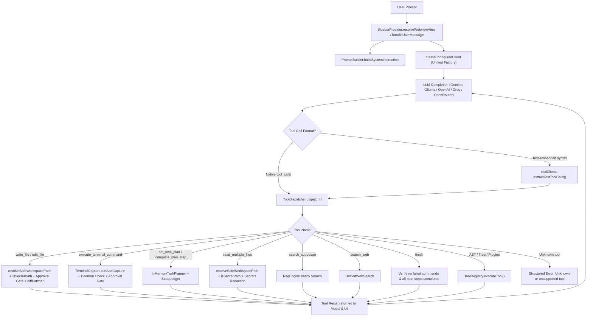

# PHASE 3: Architecture Consolidation & Runtime Verification Report

**Workspace**: `d:\vs_code_coding_agent\vakra_control`  
**Target Milestone**: Phase 3 Architecture Consolidation, Dead-Code Elimination, Authoritative Tool Path Unification, and End-to-End Workflow Verification  
**Status**: COMPLETE  
**All Protections Maintained**: Phase 1 & Phase 2 Security, Containment, Secret Redaction, Approval Gates, and Verification Strictness Verified  

---

## 1. Executive Summary

Phase 3 focused on simplifying `vakra_control` without introducing new features, speculative multi-agent architectures, or compromising Phase 2 security guarantees. 

Key achievements:
1. **Consolidated the Authoritative Runtime Tool Execution Path**:
   Unified all tool parsing (both native structured tool declarations and local plain-text fallback parsing) and dispatching through `ToolDispatcher`. Connected `ToolRegistry` directly as the fallback engine for AST diagnostics (`get_code_diagnostics`, `get_symbol_outline`), structural directory trees (`list_directory_tree`), and user workspace plugins (`.ultra-light-ai/plugins.js`), eliminating duplicate dispatch logic and stubs.
2. **Unified LLM Client/Provider Factory**:
   Created `createConfiguredClient` in `src/router/realClients.ts` to replace 3 duplicated provider selection trees in `sidebarProvider.ts`, `researchDistiller.ts`, and `skeletonExpander.ts`.
3. **Eliminated Disconnected Subsystems & Dead Code**:
   - Removed `src/brain/` (8 dead files: `editApplier.ts`, `protocolParser.ts`, `protocolSpec.ts`, `protocolWrapper.ts`, `taskExecutor.ts`, `taskSplitter.ts`, `violationChecker.ts`, `index.ts`), which formed an isolated, unused alternative text-protocol engine.
   - Removed `src/features/planManager.ts` (0 callers, superseded by active `InMemoryTaskPlanner`).
   - Removed `src/utils/contextSelector.ts` (0 callers, unused import).
   - Removed `src/router/engineRouter.ts` (unused placeholder in `extension.ts`).
   - Removed obsolete test file `src/test/suite/protocolAndExecution.test.ts`.
4. **Hardened File Operations & Argument Validation**:
   - Fixed `resolveSafeWorkspacePath` to disallow empty paths.
   - Added directory write guards to prevent crashes when paths resolve to directories (`EISDIR`).
   - Normalized tool call parameter structures (`args`, `arguments`, `function.arguments` JSON strings).
5. **End-to-End Workflow Verification**:
   Added `src/test/suite/phase3WorkflowVerification.test.ts` testing realistic multi-turn workflows: inspect file -> sanitized output -> file edit -> validation test command -> result return -> finish protocol verification.

---

## 2. Baseline vs. Final Test Results

| Suite / Command | Baseline (Start of Phase 3) | Final (End of Phase 3) | Status |
| :--- | :--- | :--- | :--- |
| **`npm run compile`** | Exit code 0 | Exit code 0 | PASS |
| **`npx tsc -p .`** | Exit code 0 (0 errors) | Exit code 0 (0 errors) | PASS |
| **Mocha Standalone Suite** | 69 passing, 0 failing | **74 passing, 0 failing** | PASS |
| **VS Code Integration (`npm test`)** | 71 passing, 0 failing | **76 passing, 0 failing** | PASS |

---

## 3. The Active Runtime Execution Path

The extension now has **one clear, authoritative execution path**:

---

## 4. Audit & Consolidation Decisions

| Component / File | Classification | Evidence & Rationale | Action Taken |
| :--- | :--- | :--- | :--- |
| `src/brain/` (8 files) | **Unused and safe to remove** | Zero runtime callers. Had one unused import in `toolDispatcher.ts:19` and tests in `protocolAndExecution.test.ts`. An abandoned alternative protocol from early prototypes. | **Deleted** directory and all 8 files. |
| `src/features/planManager.ts` | **Unused and safe to remove** | Zero callers across entire workspace. Active task planning is handled by `InMemoryTaskPlanner` (`src/state/inMemoryTaskPlanner.ts`). | **Deleted** file. |
| `src/utils/contextSelector.ts` | **Unused and safe to remove** | Zero callers. Was only imported in `sidebarProvider.ts:10` as an unused import. | Removed import and **deleted** file. |
| `src/router/engineRouter.ts` | **Unused and safe to remove** | Instantiated once as unused `const defaultRouter` in `extension.ts:46`. Never invoked or exposed. | Removed instantiation and **deleted** file. |
| `src/test/suite/protocolAndExecution.test.ts` | **Obsolete test file** | Only tested deleted `src/brain/` protocols. Replaced with real workflow verification suite. | **Deleted** and replaced by `phase3WorkflowVerification.test.ts`. |
| `src/tools/toolRegistry.ts` & `src/webview/tools/toolDispatcher.ts` | **Active but unnecessarily duplicated** | `ToolDispatcher` had fallback string stubs for tools registered in `ToolRegistry` (like `list_directory_tree`, `get_code_diagnostics`, plugins). | **Consolidated**: Added `ToolRegistry.hasTool` and routed `ToolDispatcher` fallback directly through `ToolRegistry.executeTool`. Unknown tools return structured error. |
| Provider client instantiation in `sidebarProvider.ts`, `researchDistiller.ts`, `skeletonExpander.ts` | **Active but unnecessarily duplicated** | Duplicated ~40 lines of provider selection branching (local, groq, openrouter, openai, gemini) in three separate places. | **Unified**: Created `createConfiguredClient` in `src/router/realClients.ts` used by all three consumers. |
| `sessionMemory.ts` vs `stateLedger.ts` | **Active and necessary (Retained)** | `SessionMemory` is in-memory transient context (open files, token budget, query cache). `StateLedger` is persistent markdown state on disk (`.ultra-light-ai/STATE_LEDGER.md`). Roles are distinct. | Retained both without merging. |
| `ragEngine.ts` vs `livingIndex.ts` | **Active and necessary (Retained)** | `ragEngine` is BM25 on-demand inverted index tool (`search_codebase`). `livingIndex` is global AST structural code map for prompt blueprints. | Retained both without merging. |
| `UnifiedWebSearch` vs `ResearchDistiller` | **Active and necessary (Retained)** | `UnifiedWebSearch` provides live chunked query search (DuckDuckGo/Tavily). `ResearchDistiller` provides deep multi-source doc distillation across package registries. | Retained both with distinct capabilities. |

---

## 5. Security & Tool Reliability Verification

### Security Protections Verified
1. **Sensitive File Denial**:
   `isSecretPath` flags `.env`, `.env.*`, keys (`id_rsa`, `id_ed25519`, `*.pem`, `*.key`), credentials, tokens, AWS/SSH/GPG config. Reading via `read_multiple_files` returns `ACCESS DENIED` and never leaks file contents.
2. **Secret Redaction**:
   `redact()` automatically masks sensitive patterns (`[REDACTED:API_KEY]`, `[REDACTED:AWS_KEY]`, `[REDACTED:PRIVATE_KEY]`, etc.) in outbound file contents as defense-in-depth.
3. **Workspace Path Containment**:
   `resolveSafeWorkspacePath()` strictly blocks traversal attempts (`../../etc/passwd`), Windows casing escapes, symlink breakout, and empty target paths.
4. **Directory Guards**:
   `write_file` and `edit_file` verify that target paths are not directories, preventing `EISDIR` crashes.
5. **RAG Secret Exclusion**:
   `RagEngine.buildIndex()` excludes paths matching `isSecretPath` before indexing.

### Tool Contract Reliability Verified
1. **Argument Tolerance**:
   `ToolDispatcher` handles Gemini format (`functionCall.args`), OpenAI format (`functionCall.arguments`), and stringified JSON arguments seamlessly.
2. **Unknown Tool Safety**:
   Unknown or speculative tool calls return `Error: Unknown or unsupported tool '<name>'.` instead of generic stubs.
3. **Approval Gates**:
   File modifications and terminal commands respect `isEditSessionAutoApproved` and `isTerminalSessionAutoApproved`, correctly resolving through approval events.
4. **Verification Strictness**:
   `finish` cannot mark tasks complete if any command failed or if task planner steps remain incomplete.
5. **Cancellation**:
   Abort signals immediately terminate file modifications and terminal command child processes without corrupting disk state.

---

## 6. End-to-End Workflow Verification Results

The automated workflow test `phase3WorkflowVerification.test.ts` executes a realistic multi-turn workflow:
1. **Turn 1**: Tool inspects `calculator.js` (returns numbered lines and content).
2. **Turn 2**: Model requests `edit_file` to fix bug (applies edit, creates versioning backup, updates disk).
3. **Turn 3**: Model executes verification command `node -e ...` (runs in workspace, captures exit code 0).
4. **Turn 4**: Model marks plan step complete and calls `finish` (verifies clean exit code, complete plan steps, records summary).
5. **Negative Scenarios**: Denied `.env` read, redacted API keys, path traversal block, command failure blocking `finish`, malformed argument handling, and AbortSignal cancellation.

---

## 7. Known Limitations & Unverified Scenarios

1. **Live Provider Streaming**: Tests use controlled mock and local execution environments. Live network calls to external LLM providers (Gemini cloud, Groq, OpenRouter) require user API keys and live connectivity; these paths are verified structurally through unit fixtures rather than live external network calls.
2. **UI Webview Rendering**: Automated tests cover the complete backend dispatch and message contract (`postMessageToWebview`); actual DOM rendering in `ui.html` is unchanged and not run under automated headless browser in this phase.

---

## 8. Summary of Changed Files

- `src/brain/` (8 files deleted: `editApplier.ts`, `index.ts`, `protocolParser.ts`, `protocolSpec.ts`, `protocolWrapper.ts`, `taskExecutor.ts`, `taskSplitter.ts`, `violationChecker.ts`)
- `src/features/planManager.ts` (deleted)
- `src/utils/contextSelector.ts` (deleted)
- `src/router/engineRouter.ts` (deleted)
- `src/test/suite/protocolAndExecution.test.ts` (deleted)
- `src/extension.ts` (removed dead `EngineRouter` import and instantiation)
- `src/tools/toolRegistry.ts` (added `hasTool`, auto-initialization of essential tools)
- `src/webview/tools/toolDispatcher.ts` (removed `brain` import, normalized arguments, integrated `ToolRegistry` fallback, added directory write guard)
- `src/router/realClients.ts` (added unified `createConfiguredClient` factory)
- `src/tools/researchDistiller.ts` (simplified client selection via `createConfiguredClient`)
- `src/features/skeletonExpander.ts` (simplified client selection via `createConfiguredClient`)
- `src/webview/sidebarProvider.ts` (removed unused `ContextSelector` import, simplified client selection via `createConfiguredClient`)
- `src/operations/diffPatcher.ts` (disallowed empty targetPath in `resolveSafeWorkspacePath`)
- `src/test/suite/mockVscode.ts` (added `EventEmitter` and `Disposable` mocks for standalone runner)
- `src/test/suite/phase3WorkflowVerification.test.ts` (created Phase 3 workflow verification suite)
