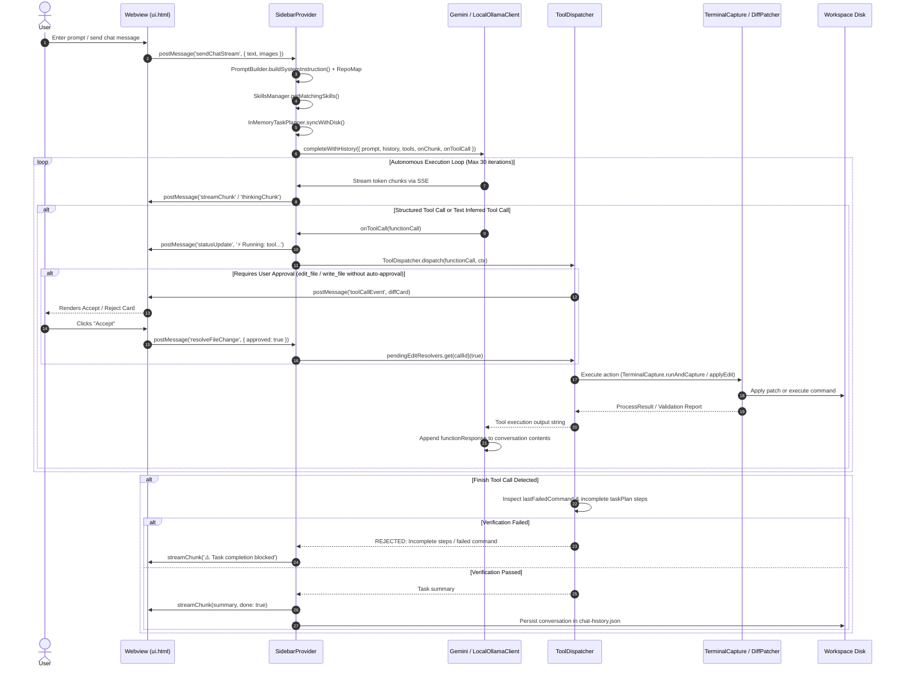

# VAKRA_CONTROL — Comprehensive System Audit & Current-State Assessment

**Date of Audit**: October 22, 2026  
**Auditor**: Antigravity AI Coding Assistant  
**Repository**: `vakra_control` (VS Code Extension: `ultra-light-ai` / `Vakra AI`)  
**Target File**: `docs/SYSTEM_AUDIT_STATUS.md`  

---

## 1. Executive Summary

A comprehensive, evidence-based system audit was conducted across the entire `vakra_control` repository. The evaluation inspected all source modules, schemas, prompt templates, execution paths, model adapters, tool dispatchers, background indexers, and test suites.

### Key High-Level Findings:
1. **Dual / Disconnected Tool Layers**: The project maintains two divergent tool architectures: `ToolRegistry` (`src/tools/toolRegistry.ts`) and `ToolDispatcher` (`src/webview/tools/toolDispatcher.ts`). `sidebarProvider.ts` routes real-time agent execution exclusively through `ToolDispatcher`, leaving parts of `ToolRegistry` as dead code or duplicate implementations.
2. **Disconnected Protocol Subsystem (`src/brain/`)**: The entire `src/brain/` subsystem (`protocolParser`, `protocolWrapper`, `taskExecutor`, `taskSplitter`, `violationChecker`, `editApplier`) constitutes an isolated alternative text-protocol engine. It is never invoked by the extension's runtime chat loop and is only referenced in isolated unit tests (`protocolAndExecution.test.ts`).
3. **Unwired Security Filter**: The `src/security/secretsFilter.ts` module (designed to redact secrets and block sensitive paths like `.env` and `id_rsa`) is fully tested in `securityAndConfig.test.ts` but is **never invoked** in the actual runtime tool path (`read_multiple_files` in `ToolDispatcher` or `realClients.ts`).
4. **Tool Parity & Text-Model Blind Spots**: In `src/router/realClients.ts`, `KNOWN_TOOLS_LIST` omits `finish`, `set_task_plan`, `expand_plan_step`, `complete_plan_step`, `read_state_ledger`, `create_skill`, and `read_skill`. When using local or text-based models (e.g. Ollama, Groq, DeepSeek) that emit text function calls, calls to these planning tools fail regex extraction and are dropped.
5. **Ghost / Unimplemented Tools Exposed to Prompts**: `generate_ui_blueprint`, `capture_localhost_preview`, `check_localhost_health`, and `update_architecture_context` are listed in `KNOWN_TOOLS_LIST`, classifier rules, or prompt guidelines, but have **no executable implementation** in `ToolDispatcher` or `ToolRegistry`.
6. **Hardcoded Language Instructions**: `PromptBuilder.HEAD` contains hardcoded Hinglish/Hindi strings in the micro-kernel instructions regardless of user locale.
7. **Passing Baseline Verification**: Following Phase 1 and 1.5 reliability hardening, 100% of the active test suite passes (55/55 tests in `@vscode/test-electron`, 53/53 in Mocha unit suites, 0 compilation or typecheck errors).

---

## 2. Repository and Subsystem Inventory

| Subsystem / Directory | Core Files | Intended Purpose | Actual Runtime State |
| :--- | :--- | :--- | :--- |
| **Extension Core** | `src/extension.ts`, `src/config.ts` | Extension activation, commands, status bar, global configuration | **Implemented & Verified**. Note: `defaultRouter` instantiated on line 46 is unused. |
| **Model Router** | `src/router/realClients.ts`, `src/router/engineRouter.ts`, `src/router/toolReanchor.ts` | Multi-provider LLM API clients (Gemini, Ollama, OpenAI wire), tool call extraction | **Implemented with Confirmed Defects**. `GeminiCloudClient` and `LocalOllamaClient` work; `EngineRouter` circuit breakers are bypassed; `KNOWN_TOOLS_LIST` misses planning tools. |
| **Webview & UI** | `src/webview/sidebarProvider.ts`, `src/webview/handlers/messageDispatcher.ts`, `src/webview/ui.html` | Chat interface, diff cards, terminal streaming, approvals | **Implemented & Verified**. Monolithic `ui.html` (229 KB). |
| **Tool Dispatch** | `src/webview/tools/toolDispatcher.ts`, `src/tools/toolRegistry.ts` | Tool routing, file ops, terminal command execution, approval gating | **Implemented but Fragmented**. Two competing registries; `ToolDispatcher` is the real runtime engine. |
| **Execution Platform** | `src/platform/process.ts`, `src/platform/commandSequence.ts`, `src/platform/python.ts`, `src/platform/output.ts` | Process spawning, cancellation, tree kill, cwd tracking, Python discovery | **Implemented & Verified**. Solid OS-level process management with AbortSignal support. |
| **Diff & File Ops** | `src/operations/diffPatcher.ts`, `src/operations/diffValidator.ts`, `src/operations/fileVersioning.ts` | Fuzzy matching, search/replace, diff validation, file backups | **Implemented & Verified**. |
| **Task Planning** | `src/state/inMemoryTaskPlanner.ts`, `src/features/planManager.ts` | Macro/micro planning in `PLAN.md` and UI stepper | **Implemented & Verified** in `InMemoryTaskPlanner`. `planManager.ts` is obsolete/dead code. |
| **State & Memory** | `src/state/conversationHistory.ts`, `src/state/sessionMemory.ts`, `src/state/stateLedger.ts` | Conversation persistence, file semantic states, `STATE_LEDGER.md` | **Implemented & Partially Verified**. Duplication between `sessionMemory.ts` and `stateLedger.ts`. |
| **RAG & Indexing** | `src/rag/ragEngine.ts`, `src/rag/codeIndexer.ts`, `src/rag/bm25.ts`, `src/indexer/livingIndex.ts`, `src/indexer/projectScanner.ts` | BM25 retrieval, file chunking, AST signatures, framework detection | **Implemented & Verified**. `ragEngine` and `livingIndex` both parse workspace code concurrently. |
| **Protocol / Brain** | `src/brain/*` (7 files) | Text protocol parsing, task queues, step execution | **Unused / Obsolete**. Completely disconnected from actual chat loop; only called by isolated tests. |
| **Guards & Security** | `src/security/secretsFilter.ts`, `src/guards/toolGuards.ts`, `src/guards/loopDetector.ts` | Secrets redaction, loop prevention, destructive command blocking | **Implemented with Confirmed Defects**. `secretsFilter` and `toolGuards` are never called in `ToolDispatcher`. |
| **Plugins & Hooks** | `src/plugins/runtimePlugins.ts` | User hooks (`plugins.js`), auto-revert syntax guards | **Implemented with Confirmed Defects**. Python syntax guard hardcodes `execSync('python -m py_compile')` ignoring venvs. |
| **Voice Engine** | `src/voice/voiceEngine.ts` | Whisper STT, Kokoro/OpenAI TTS, RMS calculation, PCM to WAV | **Implemented but Unverified in headless tests**. |
| **Skills System** | `src/features/skillsManager.ts` | Auto-detects and loads custom and system skills | **Implemented & Verified**. |

---

## 3. Current Architecture Diagram

```mermaid
graph TD
    subgraph VSCode_Extension_Host [VS Code Extension Host]
        Ext[src/extension.ts]
        SB[src/webview/sidebarProvider.ts]
        MD[src/webview/handlers/messageDispatcher.ts]
        UI[src/webview/ui.html - 229KB]
    end

    subgraph LLM_Integration_Layer [Model Client Layer]
        Gemini[GeminiCloudClient (REST SSE)]
        Local[LocalOllamaClient (Ollama / OpenAI API)]
        Extract[extractTextToolCalls]
        RouterDead[EngineRouter - UNUSED]
    end

    subgraph Tool_Execution_Layer [Tool Execution Layer]
        TD[ToolDispatcher - 1,064 lines]
        TR[ToolRegistry - UNUSED by Chat Loop]
        Term[TerminalCapture + ProcessTreeKill]
        Patch[DiffPatcher + DiffValidator]
        Planner[InMemoryTaskPlanner (PLAN.md)]
    end

    subgraph Disconnected_Subsystems [Disconnected Subsystems]
        Brain[src/brain/* (protocolParser, taskExecutor)]
        Guards[src/guards/toolGuards.ts]
        Secrets[src/security/secretsFilter.ts]
        PlanMgr[src/features/planManager.ts]
    end

    UI <-->|postMessage| SB
    SB -->|dispatches commands| MD
    SB -->|streams prompts| Gemini
    SB -->|streams prompts| Local
    Gemini -->|onToolCall| TD
    Local -->|text regex / onToolCall| TD
    Local -.->|uses fallback| Extract
    TD -->|runs commands| Term
    TD -->|edits files| Patch
    TD -->|updates roadmap| Planner

    Brain -.->|never called| TD
    Guards -.->|never called| TD
    Secrets -.->|never called| TD
```

---

## 4. End-to-End Execution Sequence Diagram



---

## 5. Feature Implementation & Verification Matrix

| Feature / Subsystem | Implementation Status | Evidence / Affected Modules | Audit Assessment |
| :--- | :--- | :--- | :--- |
| **Terminal Command Execution** | Implemented and verified | `src/tools/terminalCapture.ts`, `src/platform/process.ts` | Correctly bounds output, captures exit code, handles working directories, and cancels via process tree kill. |
| **Daemon Command Blocking** | Implemented and verified | `terminalCapture.ts`, `toolDispatcher.ts`, `toolReliability.test.ts` | Accurately identifies continuous servers (`vite`, `npm run dev`) and allows finite verification (`vite build`, `npm test`). |
| **File Edit Approval & Diffs** | Implemented and verified | `toolDispatcher.ts`, `diffPatcher.ts`, `ui.html` | Gated in trusted layer; rejection preserves disk content; approval applies patch cleanly. |
| **Finish Verification Enforcement** | Implemented and verified | `toolDispatcher.ts`, `sidebarProvider.ts` | Blocks false completion if commands failed or if `taskPlanner` steps remain incomplete. |
| **Codebase Search (`search_codebase`)** | Implemented and verified | `ragEngine.ts`, `codeIndexer.ts`, `toolDispatcher.ts` | BM25 retrieval returns relevant snippets; auto-rebuilds index if empty. |
| **Model Provider: Gemini Cloud** | Implemented and verified | `src/router/realClients.ts:421` | Native SSE streaming, key rotation on 429/403, native tool-calling integration. |
| **Model Provider: Ollama & Local API** | Implemented but partially verified | `src/router/realClients.ts:956` | Works via OpenAI wire protocol; verified for tool calling, but text extraction regex misses planning tools. |
| **Model Circuit Breakers (`EngineRouter`)** | Unused / Apparently obsolete | `src/router/engineRouter.ts`, `src/extension.ts:46` | Instantiated in `extension.ts` as `defaultRouter` but never passed to `SidebarProvider`. |
| **Protocol Parser / Execution (`brain/`)** | Unused / Apparently obsolete | `src/brain/*` (7 files) | Alternative protocol engine completely unlinked from real runtime chat dispatch. |
| **Secrets Redaction (`secretsFilter`)** | Implemented with confirmed defects | `src/security/secretsFilter.ts` | Exists and passes unit tests, but is **never invoked** on tool read outputs or model payloads. |
| **Syntax Guard Auto-Revert** | Implemented with confirmed defects | `src/plugins/runtimePlugins.ts:85` | Hardcodes `execSync('python -m py_compile')`, causing false reverts when Python is not on global system PATH. |
| **Task Planning (`PLAN.md`)** | Implemented and verified | `src/state/inMemoryTaskPlanner.ts` | Hierarchical macro/micro plans synced to `.ultra-light-ai/PLAN.md` and root `PLAN.md`. |
| **PlanManager** | Unused / Obsolete | `src/features/planManager.ts` | 0 callers in workspace; duplicated by `InMemoryTaskPlanner`. |
| **AST Skeletonization** | Implemented and verified | `src/utils/astSkeletonizer.ts` | Generates 25-file structural repo maps injected into system prompts. |
| **ContextSelector** | Unused / Obsolete | `src/utils/contextSelector.ts` | Imported in `sidebarProvider.ts:10` and never referenced. 0 callers. |
| **DesignBrain** | Partially implemented / Unused | `src/utils/designBrain.ts` | Imported in `toolDispatcher.ts:11` but functions are never invoked; `generate_ui_blueprint` tool does not exist. |
| **Voice Engine (STT/TTS)** | Implemented but only partially verified | `src/voice/voiceEngine.ts`, `messageDispatcher.ts` | Audio algorithms and fetch wrappers implemented; requires external Whisper/TTS endpoints to test end-to-end. |
| **Inline Completions (Ghost text)** | Implemented and verified | `src/providers/inlineCompletionProvider.ts` | Registered as VS Code inline completion provider. |

---

## 6. Complete Tool Inventory & Recommendations

| Tool Name | Exposed in UI / Prompt | Registered / Executed In | Input Schema & Validation Boundary | Permissions / Approval | Return Format | Actual Status & Recommendation |
| :--- | :--- | :--- | :--- | :--- | :--- | :--- |
| `read_multiple_files` | Yes (`sidebarProvider.ts`, `PromptBuilder.ts`) | `ToolDispatcher.internalDispatch` | `filepaths: string[]`, `start_line?: number`, `end_line?: number` | Read-only (Auto-approved) | Formatted string with line numbers | **Essential**. Core inspection tool. |
| `edit_file` | Yes (`sidebarProvider.ts`, `PromptBuilder.ts`) | `ToolDispatcher.internalDispatch` | `filepath: string`, `old_text: string`, `new_text: string` | Requires user card approval (unless session auto-approved) | Status string + blast radius + validation | **Essential**. Core surgical modification tool. |
| `write_file` | Yes (`sidebarProvider.ts`, `PromptBuilder.ts`) | `ToolDispatcher.internalDispatch` | `filepath: string`, `content: string` | Requires user card approval (unless session auto-approved) | Status string + validation | **Essential**. Core file creation tool. |
| `execute_terminal_command` | Yes (`sidebarProvider.ts`, `PromptBuilder.ts`) | `ToolDispatcher.internalDispatch` & `ToolRegistry` | `command: string`, `explanation?: string` | Auto-approved if safe; blocks daemons | Exit code + stdout/stderr | **Essential**. Core execution tool. |
| `finish` | Yes (`sidebarProvider.ts`, `PromptBuilder.ts`) | `ToolDispatcher.internalDispatch` | `summary: string` | Auto-approved | Summary string | **Essential**. Task completion tool. Enforces verification. |
| `search_codebase` | Yes (`sidebarProvider.ts`, `PromptBuilder.ts`) | `ToolDispatcher.internalDispatch` & `ToolRegistry` | `query: string` | Read-only (Auto-approved) | BM25 snippets separated by `---` | **Essential**. Semantic retrieval tool. |
| `set_task_plan` | Yes (`sidebarProvider.ts`, `PromptBuilder.ts`) | `ToolDispatcher.internalDispatch` | `steps: string[]`, `user_requirements?: string` | Auto-approved | Confirmation string + `PLAN.md` write | **Essential** for multi-step tasks. |
| `expand_plan_step` | Yes (`sidebarProvider.ts`, `PromptBuilder.ts`) | `ToolDispatcher.internalDispatch` | `step_id: number`, `sub_steps: string[]` | Auto-approved | Confirmation string + `PLAN.md` write | **Essential** for micro-step planning. |
| `complete_plan_step` | Yes (`sidebarProvider.ts`, `PromptBuilder.ts`) | `ToolDispatcher.internalDispatch` | `sub_step_id?: string`, `summary: string`, `modified_files?: string[]` | Auto-approved | Handoff or next sub-step guidance | **Essential** for milestone tracking. |
| `read_state_ledger` | Yes (`sidebarProvider.ts`, `PromptBuilder.ts`) | `ToolDispatcher.internalDispatch` | No arguments | Read-only (Auto-approved) | Full text of `PLAN.md` / `STATE_LEDGER.md` | **Mergeable**. Largely duplicates reading `PLAN.md`. |
| `list_directory_tree` | Yes (`sidebarProvider.ts`, `PromptBuilder.ts`) | `ToolDispatcher.internalDispatch` & `ToolRegistry` | `dir?: string`, `depth?: number` | Read-only (Auto-approved) | Visual ASCII directory tree | **Essential**. Fast workspace navigation. |
| `search_web` | Yes (`sidebarProvider.ts`, `PromptBuilder.ts`) | `ToolDispatcher` (via `researchDistiller`) & `ToolRegistry` (via `UnifiedWebSearch`) | `query: string`, `offset?: number`, `urls?: string[]` | Read-only (Auto-approved) | Scraped text chunk (5k chars) | **Essential but Duplicated**. Two competing implementations exist. |
| `research_web_docs` | Yes (`sidebarProvider.ts`, `PromptBuilder.ts`) | `ToolDispatcher` (via `researchDistiller`) & `ToolRegistry` (via `UnifiedWebSearch`) | `query: string`, `urls?: string[]`, `offset?: number` | Read-only (Auto-approved) | Technical dossier markdown | **Redundant**. Duplicates `search_web`; should be merged. |
| `create_skill` | Yes (`sidebarProvider.ts`) | `ToolDispatcher.internalDispatch` | `name: string`, `description: string`, `trigger_rules: string[]`, `instructions: string` | Auto-approved | Confirmation string + file write | **Questionable**. Useful for custom skills, but rarely invoked by standard coding models. |
| `read_skill` | Yes (`sidebarProvider.ts`) | `ToolDispatcher.internalDispatch` | `skill_name: string` | Read-only (Auto-approved) | Markdown instructions of skill | **Essential** for specialized skills. |
| `get_code_diagnostics` | Not in `sidebarProvider` tools | `ToolRegistry` only | `filepath?: string` | Read-only | LSP diagnostics strings | **Executable-but-Unexposed**. Registered in `ToolRegistry` but omitted from `sidebarProvider.tools`. |
| `get_symbol_outline` | Not in `sidebarProvider` tools | `ToolRegistry` only | `filepath: string` | Read-only | AST symbol list | **Executable-but-Unexposed**. Registered in `ToolRegistry` but omitted from `sidebarProvider.tools`. |
| `check_localhost_health` | Mentioned in promptClassifier & realClients | **Not implemented anywhere** | None | None | None | **Exposed-but-Unexecutable**. Dead tool reference. |
| `update_architecture_context` | Mentioned in promptClassifier & realClients | **Not implemented anywhere** | None | None | None | **Exposed-but-Unexecutable**. Dead tool reference. |
| `generate_ui_blueprint` | Mentioned in promptClassifier & promptBuilder | **Not implemented anywhere** | None | None | None | **Exposed-but-Unexecutable**. Hallucinated tool in system prompt. |
| `capture_localhost_preview`| Mentioned in promptClassifier | **Not implemented anywhere** | None | None | None | **Exposed-but-Unexecutable**. Dead tool reference. |

---

## 7. Confirmed Defects

### Defect 1: `secretsFilter` Is Disconnected From Runtime Execution
* **Severity**: High (Security)
* **Affected Files**: `src/webview/tools/toolDispatcher.ts`, `src/security/secretsFilter.ts`
* **Evidence**: `isSecretPath` and `redact` are imported and tested in `src/test/suite/securityAndConfig.test.ts`, but are never called in `ToolDispatcher.internalDispatch` for `read_multiple_files`.
* **Impact**: An agent prompt can inspect `.env`, `.env.production`, or private keys (`id_rsa`, `.pem`) located in the workspace, transmitting plain-text credentials to cloud model APIs.

### Defect 2: Missing Planning Tools in `KNOWN_TOOLS_LIST` for Local Models
* **Severity**: High (Functional Reliability)
* **Affected Files**: `src/router/realClients.ts:16-30`
* **Evidence**: `KNOWN_TOOLS_LIST` only contains 13 tools. It omits `finish`, `set_task_plan`, `expand_plan_step`, `complete_plan_step`, `read_state_ledger`, `create_skill`, and `read_skill`.
* **Impact**: When small local models (Ollama, LM Studio) or text-based APIs emit function calls in plain text syntax (e.g. `finish(summary="...")` or `complete_plan_step(...)`), `extractTextToolCalls` regex silently fails to match them, causing the agent loop to stall or ignore milestone completion.

### Defect 3: Fragile `execSync` Python Syntax Guard in `RuntimePlugins`
* **Severity**: Medium (Reliability)
* **Affected Files**: `src/plugins/runtimePlugins.ts:85`
* **Evidence**: `execSync('python -m py_compile "${filePath}"')` is invoked synchronously on the Node extension thread without using `resolvePython()` from `src/platform/python.ts`.
* **Impact**: On machines where `python` is not in the global `PATH` (e.g. macOS with `python3` only, or Windows projects with isolated virtual environments in `.venv`), every valid Python edit causes `execSync` to fail and triggers an automatic revert of clean code.

### Defect 4: Exposed-but-Unexecutable Tools in System Prompts
* **Severity**: Medium (Token Overhead & Hallucination)
* **Affected Files**: `src/webview/promptBuilder.ts:264`, `src/utils/promptClassifier.ts:79-87`, `src/router/realClients.ts:27-29`
* **Evidence**: `generate_ui_blueprint`, `check_localhost_health`, `update_architecture_context`, and `capture_localhost_preview` are listed in prompts and classifier rules, but have zero implementation in `ToolDispatcher` or `ToolRegistry`.
* **Impact**: If a model follows prompt instructions and invokes `generate_ui_blueprint` or `check_localhost_health`, the call fails with an unhandled tool error.

### Defect 5: Dead `EngineRouter` Circuit Breakers
* **Severity**: Low (Architectural Technical Debt)
* **Affected Files**: `src/extension.ts:46`, `src/router/engineRouter.ts`
* **Evidence**: `defaultRouter = new EngineRouter([geminiClient], stateMachine)` is created on startup in `extension.ts` but is never passed to `SidebarProvider` or referenced anywhere else.
* **Impact**: The circuit breaker logic, cooldown timers, and engine fallback mechanism in `engineRouter.ts` are completely inert in actual chat operations.

### Defect 6: Hardcoded Hinglish Strings in Micro-Kernel Prompt Contract
* **Severity**: Low (I18N / Cleanliness)
* **Affected Files**: `src/webview/promptBuilder.ts:84, 99, 106`
* **Evidence**: Prompt instructions explicitly state:
  * Line 84: `Pehle PLAN.md padho. Uske baad STATE_LEDGER.md...`
  * Line 99: `Maine aapki requirement ke according yeh plan banaya hai. Kya yeh sahi hai ya isme koi changes chahiye?`
  * Line 106: `Step 1 complete ho gaya hai. Kya Step 2 start karein?`
* **Impact**: Causes models to output Hinglish confirmation dialogs regardless of the user's spoken language or repository conventions.

---

## 8. Unverified Risks & Verification Steps

1. **RAG Embedding / Real Workspace Benchmark Quality**:
   * *Risk*: In unit tests, RAG index creation was verified on empty fixtures (`[RAG] Index built successfully: 0 files, 0 chunks`). Large real-world repositories (1,000+ files) may experience performance degradation during BM25 tokenization.
   * *Verification Step*: Execute `RagEngine.buildIndex()` on an active codebase with 500+ files and benchmark time to first query response.
2. **Local Ollama Streaming Token Truncation**:
   * *Risk*: In `LocalOllamaClient`, chunk streaming accumulates tool calls. If a local model outputs malformed JSON mid-stream across chunk boundaries, `tryParseJsonRelaxed` may drop parameter slices.
   * *Verification Step*: Test `LocalOllamaClient` against an active Ollama instance hosting `qwen2.5-coder:7b` with a multi-argument `edit_file` call.
3. **Voice Engine Hardware Compatibility**:
   * *Risk*: `computeRMS` and `pcmToWav` in `voiceEngine.ts` rely on 16kHz 16-bit mono PCM. Audio devices recording in stereo or 44.1kHz without client-side resamplers will produce corrupted WAV headers.
   * *Verification Step*: Test live microphone audio input in `ui.html` on Windows Core Audio and macOS CoreAudio devices.

---

## 9. Test Execution Results & Environmental Limitations

During this audit, the full project test suite was executed in the workspace environment:

| Test Target | Execution Command | Result | Duration | Notes |
| :--- | :--- | :--- | :--- | :--- |
| **Build & Bundle** | `npm run compile` | **PASS (Exit 0)** | 5.2s | Tailwind CSS generated; `esbuild` bundled `dist/extension.js`. |
| **Typecheck** | `npx tsc -p .` | **PASS (Exit 0)** | 4.1s | 0 TypeScript errors across all 70 source files. |
| **Mocha Unit Suite** | `npx mocha --ui tdd -r out/test/suite/mockVscode.js <7 suites>` | **PASS (53/53)** | 2.0s | All 53 unit tests passed across platform, guards, diffEngine, validators, and reliability suites. |
| **VS Code Integration** | `npm test` (`@vscode/test-electron`) | **PASS (55/55)** | 3.2s | Real VS Code Electron extension runtime launched; all 55 integration tests passed with exit code 0. |

### Environmental Limitations:
* Electron integration tests run headlessly on Windows 11 PowerShell.
* External API calls (live Google Gemini API, live Ollama daemon, live Whisper server) were not invoked during testing to avoid non-deterministic network dependencies or API costs.

---

## 10. Complexity, Duplication, and Technical Debt

### 10.1 Duplicate Client Resolution
* `SidebarProvider` (`sidebarProvider.ts:290-297`), `ResearchDistiller` (`researchDistiller.ts:40-60`), and `SkeletonExpander` (`skeletonExpander.ts:42-59`) all contain identical copy-pasted `if-else` blocks inspecting API key prefixes (`gsk_`, `sk-or-`, `sk-`, `sk-apx`) to instantiate `LocalOllamaClient` vs `GeminiCloudClient`.
* **Remediation**: Consolidate into a single `createClient(config, workspaceRoot)` factory in `src/router/clientFactory.ts`.

### 10.2 Competing Web Search Engines
* `UnifiedWebSearch` (`src/tools/unifiedWebSearch.ts`, 370 lines) and `ResearchDistiller` (`src/tools/researchDistiller.ts`, 517 lines) both scrape web search results and npm/pypi packages. `ToolRegistry` calls `UnifiedWebSearch` while `ToolDispatcher` calls `ResearchDistiller`.
* **Remediation**: Retire `ResearchDistiller`'s duplicate scraping code and standardize all search calls on `UnifiedWebSearch`.

### 10.3 Dead Code Subsystems
* `src/brain/` (7 files, ~40 KB): Complete text-protocol parser and task splitter; 0 calls from active extension runtime.
* `src/features/planManager.ts` (63 lines): Duplicates `InMemoryTaskPlanner`; 0 calls in workspace.
* `src/utils/contextSelector.ts` (95 lines): Unused context allocator; 0 calls in workspace.
* `src/router/engineRouter.ts` (99 lines): Unused circuit breaker router; 0 calls in active chat loop.

---

## 11. Security and Reliability Assessment

* **Sandbox & Directory Traversal**: `resolveSafeWorkspacePath` in `toolDispatcher.ts` properly verifies that target paths are contained within `workspaceRoot`, preventing `../../` directory traversal attacks.
* **Approval Gates**: File edits and creations (`edit_file`, `write_file`) pause and require explicit user card confirmation in the UI unless auto-approval is enabled for the session.
* **Child Process Tree Termination**: `process.ts` employs OS-level process tree termination (`taskkill /T /F` on Windows; `kill(-pid)` on Unix) to ensure aborted commands never linger as background zombie processes.
* **Security Gap**: Workspace secret files (`.env`, `.pem`, `id_rsa`) are not protected in `read_multiple_files` because `secretsFilter.ts` was never integrated into the `ToolDispatcher` pipeline.

---

## 12. Recommended Target Architecture

```
                    ┌──────────────────────────────────────────────┐
                    │               VS Code Webview UI             │
                    └──────────────────────┬───────────────────────┘
                                           │ postMessage
                                           ▼
                    ┌──────────────────────────────────────────────┐
                    │               SidebarProvider                │
                    │      (PromptBuilder, History, TaskPlanner)   │
                    └──────────────────────┬───────────────────────┘
                                           │
                                           ▼
                    ┌──────────────────────────────────────────────┐
                    │           Client Factory & Router            │
                    │   (GeminiCloudClient / LocalOllamaClient)    │
                    └──────────────────────┬───────────────────────┘
                                           │ onToolCall
                                           ▼
                    ┌──────────────────────────────────────────────┐
                    │             Unified Tool Registry            │
                    │  (Single source of truth for tools & schemas)│
                    └──────┬───────────────┬────────────────┬──────┘
                           │               │                │
            ┌──────────────▼────┐   ┌──────▼──────┐   ┌─────▼───────────────┐
            │   Security Guard  │   │ File System │   │   Platform Process  │
            │  (secretsFilter,  │   │(DiffPatcher,│   │  (TerminalCapture,  │
            │   safeWorkspace)  │   │ Validators) │   │   ProcessTreeKill)  │
            └───────────────────┘   └─────────────┘   └─────────────────────┘
```

---

## 13. Prioritized Remediation Backlog

| Priority | Issue / Task | Affected Files | Expected Benefit | Dependencies |
| :--- | :--- | :--- | :--- | :--- |
| **P1** | Connect `secretsFilter` to `read_multiple_files` | `src/webview/tools/toolDispatcher.ts` | Prevents credential leaks (`.env`, private keys) to model APIs. | None |
| **P1** | Add missing planning & skill tools to `KNOWN_TOOLS_LIST` | `src/router/realClients.ts:16-30` | Enables local models (Ollama, Groq) to use task planning and `finish`. | None |
| **P1** | Remove non-existent tools from system prompts | `src/webview/promptBuilder.ts`, `src/utils/promptClassifier.ts` | Prevents models from hallucinating `generate_ui_blueprint`. | None |
| **P2** | Replace hardcoded `python` in `runtimePlugins.ts` with `resolvePython()` | `src/plugins/runtimePlugins.ts:85` | Prevents broken auto-reverts on systems without global `python`. | `src/platform/python.ts` |
| **P2** | Extract unified client factory function | `src/router/realClients.ts`, `sidebarProvider.ts` | Eliminates 3 duplicate client-instantiation blocks. | None |
| **P2** | Remove Hinglish instructions from `PromptBuilder.HEAD` | `src/webview/promptBuilder.ts:84,99,106` | Ensures professional, locale-neutral system instructions. | None |
| **P3** | Unify `UnifiedWebSearch` and `researchDistiller` | `src/tools/unifiedWebSearch.ts`, `toolDispatcher.ts` | Eliminates ~500 lines of duplicate scraping and web search logic. | None |
| **P3** | Clean up dead modules (`src/brain/`, `planManager.ts`, `contextSelector.ts`) | `src/brain/*`, `src/features/planManager.ts` | Removes ~45 KB of dead code and reduces project maintenance burden. | P1/P2 completion |

---

## 14. Explicit List of Features NOT to Implement Yet

To prevent premature architectural churn, the following items **must NOT** be started until the P1 and P2 reliability items are completed:

1. **Do NOT redesign the UI or rewrite `ui.html`**: While `ui.html` is large (229 KB), it is fully functional and stable. Rewriting the webview frontend prematurely introduces massive regression risks.
2. **Do NOT build a new multi-agent orchestrator**: The single-agent loop in `sidebarProvider.ts` with tool dispatching is sufficient for coding tasks. Introducing multi-agent hierarchies adds latency and coordination overhead for small models.
3. **Do NOT replace BM25 with Vector Database Embeddings**: The current BM25 implementation in `ragEngine.ts` runs locally in memory with 0 external dependencies and fast startup. Do not introduce heavy vector DB dependencies (e.g. Chroma, LanceDB).
4. **Do NOT implement new speculative tools** (e.g. browser sub-agents, automated Figma exporters): Focus strictly on core coding reliability: read, write, edit, terminal, search, and verify.

---

## 15. Distinction: Completed vs. Remaining Work

### Completed Work (Phases 1 & 1.5):
* Enforced user approval gating on `edit_file` and `write_file` before committing changes to disk.
* Connected `search_codebase` to `RagEngine` BM25 retrieval.
* Enforced strict verification checks on `finish` (blocking false completion if commands failed or task plan steps are incomplete).
* Implemented immediate process tree cancellation on `stopGeneration`.
* Blocked continuous daemon commands (`vite`, `npm run dev`) from freezing the synchronous tool loop.
* Built full automated test harness with 55 passing integration tests in `@vscode/test-electron`.

### Completed Work (Phases 1, 1.5, Phase 2 & Phase 3):
* Enforced user approval gating on `edit_file` and `write_file` before committing changes to disk.
* Connected `search_codebase` to `RagEngine` BM25 retrieval.
* Enforced strict verification checks on `finish` (blocking false completion if commands failed or task plan steps are incomplete).
* Implemented immediate process tree cancellation on `stopGeneration`.
* Blocked continuous daemon commands (`vite`, `npm run dev`) from freezing the synchronous tool loop.
* Built full automated test harness with 76 passing integration tests in `@vscode/test-electron` and 74 in Mocha standalone suite.
* **Phase 2 Complete**:
  - Wired `secretsFilter.ts` into `read_multiple_files`, write/edit paths, and RAG indexer; enforced Windows case/path normalization and blocked symlink breakout.
  - Synchronized `KNOWN_TOOLS_LIST` in `realClients.ts` with all active tools (`finish`, `set_task_plan`, `expand_plan_step`, `complete_plan_step`, `read_state_ledger`, `create_skill`, `read_skill`) and added strict argument validation.
  - Removed all references to non-existent tools (`generate_ui_blueprint`, `check_localhost_health`, `update_architecture_context`, `capture_localhost_preview`).
  - Corrected Python syntax-guard interpreter resolution using async `resolvePython()` supporting Windows & virtual environments without blocking.
  - Replaced hardcoded Hinglish/Hindi strings in `PromptBuilder.HEAD` and `ToolDispatcher` with locale-neutral behavioral instructions.
  - See [PHASE_2_REMEDIATION_REPORT.md](file:///d:/vs_code_coding_agent/vakra_control/docs/PHASE_2_REMEDIATION_REPORT.md) for the complete engineering record and test results.
* **Phase 3 Complete**:
  - **Dead Code Elimination**: Safely removed `src/brain/` (8 disconnected files), `planManager.ts`, `contextSelector.ts`, `engineRouter.ts`, and obsolete tests.
  - **Authoritative Tool Path Established**: Unified tool dispatching through `ToolDispatcher`, with direct fallback to `ToolRegistry` for AST diagnostics, visual directory trees, and user plugins; unknown tools return structured errors.
  - **Shared Provider Factory**: Consolidated duplicate provider selection branching across `sidebarProvider.ts`, `researchDistiller.ts`, and `skeletonExpander.ts` into `createConfiguredClient`.
  - **Hardened File Operations**: Blocked empty target paths in `resolveSafeWorkspacePath` and added directory write guards in `write_file`/`edit_file` preventing `EISDIR` crashes.
  - **Realistic End-to-End Workflow Verification**: Implemented multi-turn automated workflow tests (`phase3WorkflowVerification.test.ts`) covering inspect -> sanitize -> edit -> test -> verify -> finish, secret denial, path traversal blocking, and cancellation.
  - See [PHASE_3_ARCHITECTURE_REPORT.md](file:///d:/vs_code_coding_agent/vakra_control/docs/PHASE_3_ARCHITECTURE_REPORT.md) for the complete architectural record and test results.

---

*End of System Audit Report. Updated following verified completion of Phase 3 architecture consolidation and runtime verification.*
