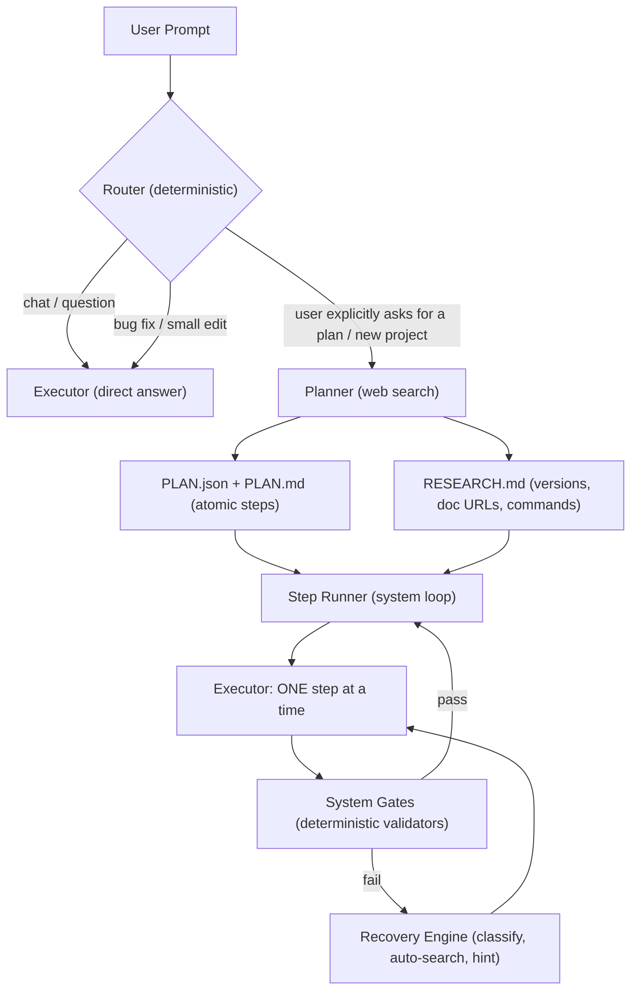
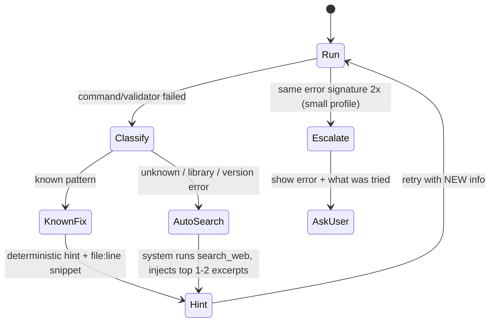

# Vakra AI: Improvement Strategy for Small Models (4B)

> **Goal:** Make Vakra AI work reliably on small local models (Gemma E4B, Qwen 4B class) without breaking it for large models.
>
> **Core principle:** A 4B model can write a correct file, but it cannot keep a whole project in its head. So the **system** has to handle planning state, environment knowledge, wiring checks, verification, and error recovery. The **model** should only get one small, well-defined job at a time.

---

## 0. Problems We Found (Evidence from `D:\test\test2`)

| # | Problem | Type | Evidence |
|---|---|---|---|
| P1 | Verifier still runs on every step and kills the task after 2 attempts (the synthetic "Step 1.1") | System bug | `agentOrchestrator.ts` still calls `VerifierRoleHandler`; direct tasks get a fake step `1.1` with `maxAttempts: 2` |
| P2 | Coder isn't allowed to finish or mark a step complete, so a Verifier handoff happens every time | System bug | `permissions.ts` blocks `complete_plan_step` and `finish` for the coder |
| P3 | The model never searched the web when commands failed | System bug + model limit | Prompt says `search_web`, but `sidebarProvider.ts` only registers `research_web_docs`. No automatic search on failure. |
| P4 | Linux commands were run on Windows (`touch`, `head`, `mkdir -p`, `2>&1`) | Model limit | 11 failed commands in `SESSION_MEMORY.json` |
| P5 | Code was written through the terminal (`python -c "open().write()"`), and PowerShell quoting corrupted it | Model limit + no guard | `auth/views.py` ended up with an unterminated string |
| P6 | Project was never wired: apps missing from `INSTALLED_APPS`, `TEMPLATES.DIRS` empty, no view renders a template, `` names don't match | Model limit (cross-file memory) | `config/settings.py`, `products/views.py`, `templates/products.html` |
| P7 | Reserved or conflicting names (local app called `auth`) | Model limit | `D:\test\test2\auth` |
| P8 | Plan steps were far too big ("Build the full premium UI") and got marked `[x]` without proof | System design | `PLAN.md`: all 5 steps checked, project doesn't run |
| P9 | Packages were never installed or checked (`rest_framework` missing), and the model retried pip with typos | Model limit + no env check | `djangorestframewor` typo; repeated `pip install` |
| P10 | Context overload: ledger dumps, full files, and long tracebacks were truncated in the middle | System design | `STATE_LEDGER.md` is 33 KB; tracebacks show "TRUNCATED 12 LINES" right where the real error is |

**Conclusion:** About 60% of these failures can be fixed in the system with deterministic code. The other 40% are real model limits, and those have to be designed around (smaller steps, checkers, recipes) instead of fixed with better prompts.

---

## 1. Target Architecture (Simple, Linear, 2 Agents)



### Rules
1. **Only 2 LLM roles:** `planner` (runs only when the user asks for a plan or starts a new project) and `executor` (does everything else).
2. **Delete the Verifier as an LLM role.** Verification is done by **system code** (validators), never by an LLM guessing which commands to run.
3. **No synthetic "Step 1.1" with a 2-attempt kill.** Direct tasks run in a bounded loop with a budget (e.g., 25 tool calls), plus loop detection and escalation. They don't stop after a fixed number of attempts.
4. **The executor may call `finish`.** The system accepts `finish` only if the gates pass (see §6).

### Files affected
- `src/agents/agentOrchestrator.ts`: remove the verifier turn, remove the synthetic step cutoff, add a Step Runner
- `src/agents/permissions.ts`: collapse to 2 roles, let the executor call `finish` / `complete_plan_step`
- `src/agents/roles/verifierRole.ts`, `researcherRole.ts`: delete (move research into the planner)
- `src/agents/prompts/rolePrompts.ts`: 2 prompts only
- Tests: update `multiAgentWorkflow.test.ts` and `multiAgentContracts.test.ts` to the new contract

---

## 2. Model Capability Profiles (One System, Different Behavior per Model Size)

Large models work today because they can handle freedom. Small models need structure. **Don't build two systems. Build one system with a profile switch.**

| Setting | `small` (≤ 5B) | `medium` (7–14B) | `large` (cloud / 30B+) |
|---|---|---|---|
| Tools exposed per turn | 5–6 (step-relevant only) | 10 | all |
| Tool calls per turn | 1 | 1–3 | parallel |
| Step granularity | 1 file **or** 1 command | 1 feature | 1 milestone |
| Context packet budget | ~3K tokens | ~8K | ~32K+ |
| Constrained decoding (grammar/JSON schema) | **ON** | optional | off |
| Auto web search on failure | **system-triggered** | system-suggested | model decides |
| Framework recipes | **mandatory** | recommended | optional hints |
| Max retries per error signature | 2, then escalate | 3 | 4 |

- Pick the profile automatically from the model name or parameter count (e.g., `e4b`, `4b`, `3b` → `small`), and let the user override it in settings.
- Files: `src/config/modelProfile.ts` (already has `sanitizeProfile`), `realClients.ts`, `agentOrchestrator.ts`

---

## 3. Tool Surface: Small, Consistent, Verified

### 3.1 Single source of truth for tools
- Move all tool schemas out of `sidebarProvider.ts` into `src/tools/toolCatalog.ts`.
- Prompts get tool names **generated from the catalog**, never hardcoded. That makes the `search_web` vs `research_web_docs` mismatch (P3) impossible.
- **Contract test:** every tool name mentioned in any prompt must exist in the catalog. CI fails otherwise.

### 3.2 Minimal small-model toolset
| Tool | Purpose |
|---|---|
| `read_file` (alias for `read_multiple_files`) | read with line numbers |
| `write_file` | create or overwrite |
| `edit_file` | surgical replace |
| `run_command` | terminal (sanitized, see §4) |
| `search_web` | search + fetch top result (merge `research_web_docs` into it, with an optional `url` param) |
| `finish` | done (gated) |

Other tools (`list_directory_tree`, `get_code_diagnostics`, `search_codebase`) are **called by the system automatically** and their output is put into the context packet. The small model doesn't need to decide to call them.

### 3.3 Tool-call reliability
1. **Constrained decoding for small models:** send a `json_schema` / GBNF grammar to llama-server and the `format` schema to Ollama (we already have `buildActionSchema` in `toolReanchor.ts`, so wire it in for the `small` profile). This removes malformed output, XML-vs-JSON confusion, and plural `filepaths`.
2. **Keep the tolerant parser** (`extractTextToolCalls` with the XML/tag/JSON/function forms) as a fallback for servers that don't support grammars.
3. **Argument normalizer layer** (already partly done): `filepaths` → `filepath`, strip triple quotes, `cmd` → `command`. Add unit tests for every alias.

---

## 4. Environment Intelligence (So the Model Stops Guessing the OS)

### 4.1 Environment snapshot (system-collected at session start, cached)
```
OS: Windows 11 | Shell: PowerShell 5.1 | Path sep: \
Python: 3.12.4 at C:\...\python.exe | venv: none | pip: 24.0
Node: 24.19 | npm: 10.x
Installed (relevant): django 6.1, (djangorestframework NOT installed)
Project type detected: django (manage.py, config/settings.py)
```
- Refresh it after any `pip install`, `npm install`, or `startapp`.
- Put it at the top of **every** executor context packet (~150 tokens).
- File: `src/platform/envScanner.ts` (exists, so extend it with installed packages and project type).

### 4.2 Shell sanitizer (deterministic rewrite before execution)
| Model writes | System runs on Windows |
|---|---|
| `touch a/b.py` | `New-Item -ItemType File -Force a/b.py` |
| `mkdir -p x/y` | `New-Item -ItemType Directory -Force x/y` |
| `cmd1 && cmd2` | `cmd1; if ($?) { cmd2 }` |
| `... \| head -n 50` | `... \| Select-Object -First 50` |
| `cat file` | `Get-Content file` |
| `2>&1` on native commands | handled by capture layer, stripped |
| `rm -rf x` | **blocked** (destructive), ask user |

- Always tell the model what was rewritten: `[Shell] 'touch' was translated to PowerShell New-Item.` This way it learns within the session.
- File: `src/platform/commandSequence.ts` / `TerminalCapture`

### 4.3 Hard guards
- **Block code writing through the terminal** (`python -c "open(...).write"`, `echo ... >`, `Set-Content`, heredocs). Return: `Use write_file to create files. Terminal file writes are blocked.` (Fixes P5.)
- **Package name resolver:** map common import names to pip names (`rest_framework` → `djangorestframework`, `PIL` → `pillow`, `cv2` → `opencv-python`, `yaml` → `pyyaml`). On `ModuleNotFoundError`, the system suggests the exact install command. (Fixes P9.)
- **Always use the interpreter:** rewrite `pip install` to `python -m pip install` with the detected interpreter.

---

## 5. Recovery Engine (System-Driven, Not Model-Driven)

Small models don't step back and change strategy on their own after a failure, so the system has to make that switch for them.



### 5.1 Error classifier (regex, deterministic)
| Pattern | Action |
|---|---|
| `SyntaxError ... File "x.py", line N` | Inject lines N-5..N+5 of `x.py` and say "fix this line using edit_file" |
| `ModuleNotFoundError: No module named 'X'` | Package resolver → exact `python -m pip install <pkg>` |
| `ImportError: cannot import name 'A' from 'B'` | Inject the symbol outline of B and list what actually exists |
| `TemplateDoesNotExist` | Run the wiring checker (§7) and show the `TEMPLATES.DIRS` status |
| `NoReverseMatch` | Show the URL names that actually exist |
| `is not recognized as the name of a cmdlet` | Shell sanitizer hint |
| `pip ... error` | Show the last 15 lines of pip output and check the package name spelling |
| anything else / framework version error | **Auto search_web** with `<framework> <version> <error first line>` |

### 5.2 Traceback compression (fixes P10)
- Never truncate the **middle** of a traceback. Keep the **first line, the last 8 lines, and every frame inside the workspace**. Drop frames from site-packages. The real error is almost always in the last lines.

### 5.3 Anti-loop
- Error signature = `hash(error type + file + line)`. Same signature twice with no file change in between → block the retry and force strategy change (search or ask the user). This is Gravitas invariant #4.

---

## 6. Deterministic Gates (Replace the LLM Verifier)

After every executor step, the **system** runs validators chosen by project type. It doesn't ask the LLM.

| Project type | Gate after file write | Gate after step |
|---|---|---|
| Python (any) | `python -m py_compile <file>` | — |
| Django | py_compile | `python manage.py check` + **wiring checker** |
| Node/TS | `tsc --noEmit` (if tsconfig) | `npm test` if defined |
| HTML/CSS/JSON | existing validators (`validateFile`) | — |

- A step counts as complete only when its gate passes **after** the last write (Gravitas invariant #3).
- `finish` is rejected if the last gate failed. The rejection message includes the exact failing output.
- `PLAN.md` gets a checkbox only after its gate passes. No more fake `[x]` (fixes P8).

---

## 7. Project Integrity Checker (The Missing Piece for "Connections")

This is the **most important new component**. A 4B model can't track cross-file wiring, so the system should check it with static analysis and give the model **one concrete wiring fix at a time**.

### 7.1 Django integrity rules (first implementation)
| Check | How |
|---|---|
| Every folder with `apps.py` is in `INSTALLED_APPS` | parse `settings.py` (AST via `python -c` helper script) |
| `rest_framework` is in `INSTALLED_APPS` if imported anywhere, and is installed | grep imports + pip list |
| `TEMPLATES.DIRS` includes `BASE_DIR / 'templates'` if a root `templates/` exists | AST |
| Every `include('x.urls')` points to an existing module | file check |
| Every `views.X` referenced in `urls.py` exists in `views.py` | AST |
| Every `` / `'ns:name'` in templates matches a defined URL name | regex + URL map |
| Every `` / `` file exists | file check |
| At least one view renders HTML when the task asks for a UI | AST: `render(` / `TemplateView` |
| No reserved app names (`auth`, `admin`, `django`, `test`, `site`) | name check |
| Single `User` model, and `AUTH_USER_MODEL` is set if a custom `User` exists | AST |
| Migrations exist for models | `makemigrations --check --dry-run` |

### 7.2 Output format (short, actionable, one at a time for small models)
```
[INTEGRITY] 3 issues. Fix #1 first:
#1 App 'products' has apps.py but is NOT in INSTALLED_APPS (config/settings.py line 33).
   Fix: edit_file config/settings.py, add 'products', to INSTALLED_APPS.
#2 TEMPLATES.DIRS is empty but templates/ exists.
#3 templates/products.html line 44 uses , defined names: products:product-list.
```
- `small` profile: send only issue #1. `large` profile: send the whole list.
- Design it as a plugin interface: `IntegrityChecker { detect(root): boolean; check(root): Issue[] }`, with Django first and Node/React/Flask/FastAPI later.
- File: new `src/integrity/djangoChecker.ts` + `src/integrity/index.ts`

---

## 8. Planner: Atomic Steps + Research Doc

### 8.1 When the planner runs
- Only when the user asks for a plan, or for a new project scaffold. For bug fixes and edits, the executor goes directly.

### 8.2 Output 1: `PLAN.json` (machine) + `PLAN.md` (human), in one location only
Each step is **atomic** and has a **system-checkable done condition**:
```json
{
  "id": 3,
  "title": "Create products app",
  "action": "command",
  "command": "python manage.py startapp products",
  "files": [],
  "done_when": ["exists:products/apps.py", "integrity:installed_apps:products"],
  "docs": ["https://docs.djangoproject.com/en/6.1/ref/django-admin/#startapp"]
}
```
- Step types: `command` | `write` | `edit` | `wire`.
- **Small profile limit:** each step touches at most 1 file or runs 1 command. A 5-milestone plan becomes about 20–40 micro-steps. That's fine, because the system runs them in a loop.
- The planner uses **recipes** (§9) as a skeleton so a 4B planner doesn't have to invent the step order.

### 8.3 Output 2: `RESEARCH.md`
- Framework and package versions confirmed via `search_web` (e.g., Django 6.1, DRF 3.x)
- Official scaffold commands
- 3–6 authoritative doc URLs mapped to step IDs
- Known pitfalls for this version
- The executor gets **only the doc URLs relevant to its current step**, not the whole report.

---

## 9. Framework Recipes (Skills Used as Deterministic Playbooks)

A recipe is a pre-written, tested step skeleton for a common stack. It removes the need for the model to remember the right order.

**Example: `recipes/django-web.yaml`**
1. `python -m pip install django` (skip if installed)
2. `django-admin startproject config .`
3. For each app: `python manage.py startapp <app>` → **wire step**: add to `INSTALLED_APPS`
4. **Wire:** `TEMPLATES.DIRS = [BASE_DIR / 'templates']`, `STATICFILES_DIRS`
5. Models per app → `makemigrations` → `migrate`
6. Views (render templates) → app `urls.py` → include in root `urls.py`
7. `templates/base.html` → page templates (with URL names from step 6)
8. Gate: `manage.py check` + integrity checker + `runserver` smoke test (start, curl `/`, stop)

- Start with: `django-web`, `django-drf-api`, `flask`, `fastapi`, `react-vite`, `node-express`.
- The planner fills in the recipe (app names, models). It doesn't invent the structure.
- Files: `src/recipes/*.yaml` + loader. Reuse the existing `read_skill` / skills infra.

---

## 10. Context Engineering: The "Step Packet"

A fresh, small context for every step instead of an ever-growing chat history.

```
[ENV]        OS/shell/python/installed pkgs (150 tok)
[GOAL]       one-line project goal (50 tok)
[STEP]       current atomic step + done_when (100 tok)
[FILES]      only files this step touches, with line numbers (≤ 1500 tok)
[RELATED]    signatures of directly imported symbols (≤ 300 tok)
[DOCS]       1 relevant doc excerpt if fetched (≤ 500 tok)
[LAST ERROR] compressed traceback + classifier hint (≤ 300 tok)
[TOOLS]      5-6 tools (generated from catalog)
```
- Total ≤ about 3K tokens for `small`.
- **Reset history between steps.** Progress lives in `PLAN.json` + integrity state, not in chat memory.
- Remove large ledger dumps from prompts. `STATE_LEDGER.md` becomes a human log only, never injected whole.
- Files: `src/webview/promptBuilder.ts`, `src/agents/prompts/rolePrompts.ts`, `realClients.ts` (history pruning)

---

## 11. Bug-Fix Mode (No Plan, Executor Only)

Flow for "fix this error" or "this isn't working":
1. System auto-collects: last terminal error, the files in the traceback (with lines), `get_code_diagnostics`, integrity issues.
2. Executor gets a step packet with that evidence already attached, so it doesn't have to find it.
3. Executor edits → system gate → if the same error comes back, the Recovery Engine (§5) runs an auto-search.
4. Budget: 25 tool calls. On exhaustion: report what was tried and what's still failing (honest report, no fake success).

---

## 12. Evaluation Harness (Measure It, Don't Assume It Works)

### 12.1 Benchmark suite (`bench/tasks/*`)
| Tier | Task examples |
|---|---|
| T1 Micro | add a function + test; fix a SyntaxError; rename a variable across 2 files |
| T2 Small feature | add a Django view + URL + template to an existing project |
| T3 Scaffold | create a Django app with 1 model and a list page that renders |
| T4 Bug hunt | broken project (like `test2`) → make `manage.py check` + integrity pass |
| T5 Full project | small e-commerce (expected to be hard for 4B) |

### 12.2 Metrics (logged automatically per run)
- Tool-call parse success rate
- Gate pass rate per step, and average retries per step
- Number of auto-searches triggered, and fix rate after a search
- Linux-command rewrites count, blocked terminal-writes count
- Task success (final gate + integrity all green)

### 12.3 Models to test
- Gemma E4B, Qwen 4B class (small), Qwen 14B (medium), one cloud model (large, regression check)

### 12.4 Release rule
- No change merges if T1–T3 success drops for any profile, or if the large-model score regresses.

---

## 13. Phased Roadmap

| Phase | Scope | Key deliverables | Done when |
|---|---|---|---|
| **1. Stop the bleeding** | P1, P2, P3 | Remove LLM verifier + synthetic step cutoff; executor can `finish` (gated); tool catalog + prompt/tool contract test; `search_web` unified | 2-role flow passes all tests; no "Step 1.1 failed" possible |
| **2. Environment** | P4, P5, P9 | Env snapshot with packages; shell sanitizer; terminal-write block; package resolver; `python -m pip` | Linux commands auto-translated on Windows; `test2`-style pip typos are corrected |
| **3. Recovery** | P10, P3 | Error classifier; traceback compressor; auto-search on unknown errors; signature anti-loop | Benchmark T4 shows auto-search triggering; no identical retries |
| **4. Gates + Integrity** | P6, P7, P8 | Deterministic validators per project type; Django integrity checker; `PLAN.md` ticks only on gate pass | Running the checker on `test2` reports all 6 wiring issues correctly |
| **5. Planner + Recipes** | P8 | Atomic `PLAN.json`; `RESEARCH.md`; Django recipe first | 4B model completes T3 (Django app + page renders) |
| **6. Context + Profiles** | P10 | Step packet; history reset per step; profile auto-detect; constrained decoding for small | Small profile prompt ≤ 3K tokens; parse rate ≥ 95% |
| **7. Eval + polish** | all | Benchmark harness, metrics dashboard, README "what to expect" table | Published numbers per model in README |

**Priority order is important:** Phases 1–3 make the existing system honest and stable. Phase 4 (integrity checker) is the biggest single improvement for the "connections" problem.

---

## 14. Honest Expectations After This Plan

| Task | 4B today | 4B after plan (expected, must be measured) |
|---|---|---|
| Single-file bug fix | sometimes | **reliable** |
| Add a feature to an existing project | weak | **good** (with integrity checker) |
| Django app scaffold with 1–2 pages | fails wiring | **achievable** via recipe + atomic steps + checker |
| Full e-commerce with auth, payments, premium UI | fails | **partial**: the skeleton will run and be wired, but quality and depth stay limited by the model |
| Large models | good | **unchanged or better** (profile `large` keeps full freedom) |

> We're not making a 4B model smarter. We're building a system around it where it only has to do what it's good at: writing one correct file at a time. The system handles memory, the environment, wiring, and verification.

---

## 15. Gravitas Compliance Checklist (Apply to Every Phase)
- [ ] Ground before changing anything: read the target files, tests, and callers first
- [ ] Every phase has a measurable "Done when" backed by test or benchmark output
- [ ] No byte-identical retries after a failure
- [ ] Contract tests for the prompt ↔ tool catalog ↔ permissions
- [ ] Report real results: benchmark numbers in README, including failures
- [ ] Mark unverified claims as unverified

